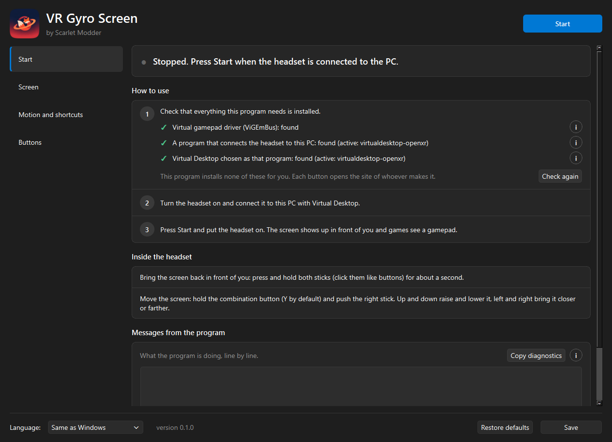
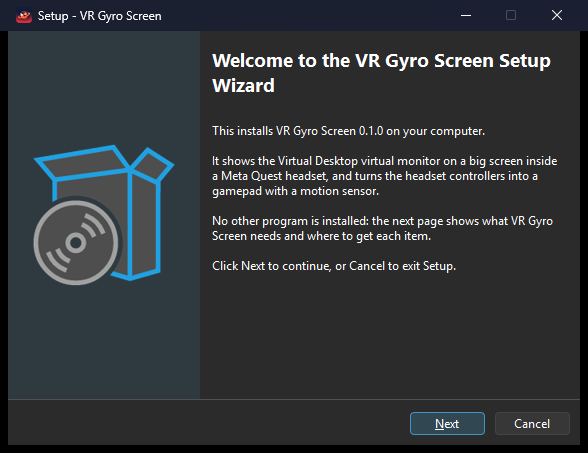
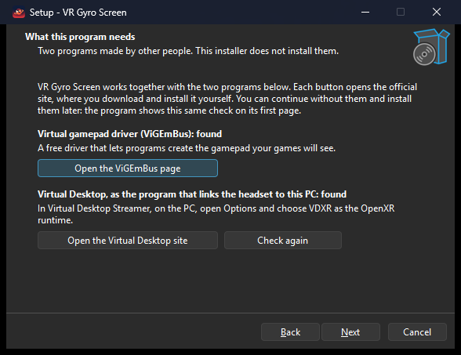
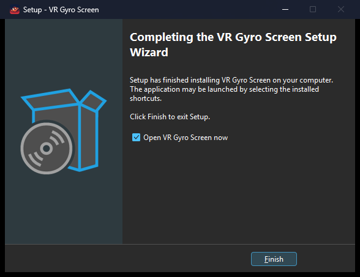
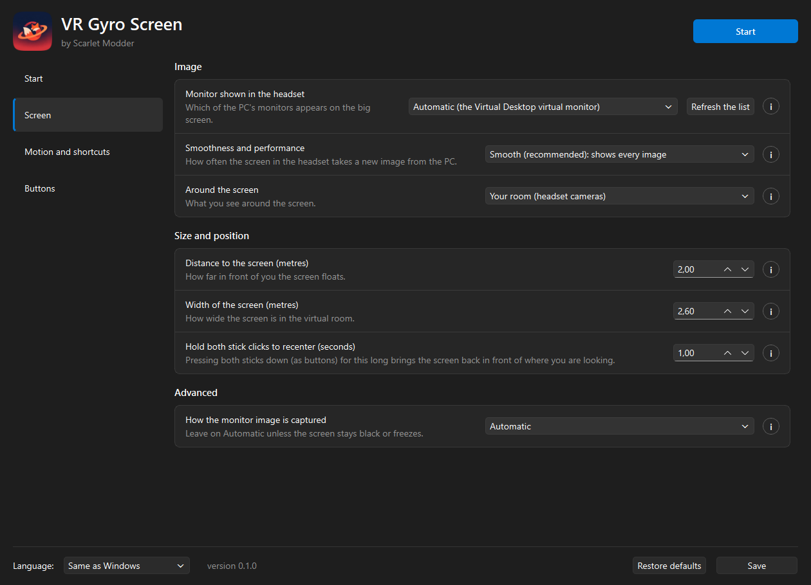
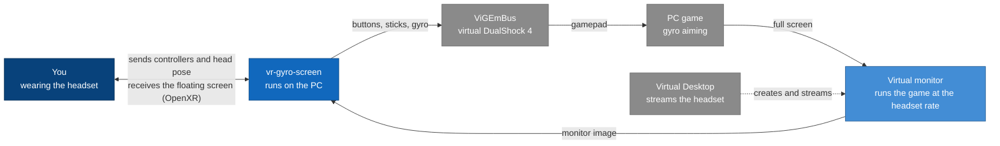

**English** | [Português](README.pt-BR.md)

<div align="center">

# 🎮 VR Gyro Screen

**Play your favorite flat-screen PC games on a giant screen inside your VR headset, with the headset controllers in your hands.**

The game appears on a big floating screen in front of you, and the controllers work as a gamepad that also aims when you move your hand.

[](#-what-you-need)
[](#-what-you-need)
[](https://www.vrdesktop.net)
[](README.pt-BR.md)
[](../../releases/latest)
[](LICENSE)
[](#%EF%B8%8F-status-and-next-steps)

### [⬇️ Download the latest version](../../releases/latest)

[What you need](#-what-you-need) · [Install](#-download-and-install) · [Play](#-play-for-the-first-time) · [Problems?](#-if-something-goes-wrong) · [All the guides](#-guides)



</div>

## 👋 What it is

VR Gyro Screen is a free program for Windows. You open it, press **Start**, put the headset on, and:

- **the game is on a big screen in front of you**, floating in your room or in a dark space, as you prefer;
- **the headset controllers become a gamepad**, with every button and both sticks;
- **you aim by moving your hand**, in games that support motion aiming (also called gyro aiming).

It is made for ordinary PC games, the ones you would play on a monitor. It does not turn them into VR games: it gives you a huge screen and a comfortable way to hold the controls.

Everything is adjusted in one window, in English or Portuguese, and every option has an **i** button that explains it in plain words.

## 🎯 Why it exists

I wanted to play ordinary PC games, the flat-screen kind, inside my VR headset: a huge screen in front of me, and the headset controllers in my hands. I also wanted to aim by pointing the controller at the screen, the way a gamepad with motion sensors does.

The ready-made options did not get me there. The "controllers as gamepad" mode of Virtual Desktop creates a controller **without a gyroscope**. Playing through the mirrored desktop kept me at the 60 Hz of my physical monitors.

So I built this app.

## ✅ What you need

| You need | What it is |
|---|---|
| A PC with Windows 11 | Where the game and this program run |
| A Meta Quest headset | The only headset tested so far |
| [Virtual Desktop](https://www.vrdesktop.net) | The app that connects the headset to the PC. It goes on the headset and on the PC, and it is made by another company |
| [ViGEmBus](https://github.com/nefarius/ViGEmBus/releases) | A free driver that lets programs create a gamepad for your games |

You do not have to check any of this by hand. The installer and the program itself show whether each item was found, and open its official site when it was not.

## ⬇️ Download and install

1. Open the [**latest version**](../../releases/latest) and download the file `VRGyroScreen-Setup-vX.Y.Z.exe`.
2. Run it. It installs only for your Windows user and does not ask for an administrator password.

   

3. One page shows what the program needs and whether each item was **found**. A button opens the official site of each one. The installer does not install other programs for you.

   

4. On the last page, press **Finish**. The program opens.

   

To remove it later, use the Windows list of installed apps. Every page of the installer is in the [usage guide](docs/usage.md).

## ▶️ Play for the first time

> [!IMPORTANT]
> Two things to switch off once, or the controls misbehave:
> - in Virtual Desktop, on the **INPUT** tab, the option **Use controllers as gamepad**;
> - in the headset settings, **hand tracking**.

1. Turn the headset on and connect it to the PC with Virtual Desktop.
2. Open **VR Gyro Screen** from the Start menu.
3. Press **Start** and put the headset on. The screen shows up in front of you.
4. Open your game. In its controller settings, turn **gyro aiming** (motion aiming) on if you want to aim with your hand.
5. When you are done, press **Stop**, or just close the window.

Inside the headset:

- **Bring the screen back in front of you:** press both sticks down (like buttons) and hold for a second.
- **Move the screen:** hold **Y** and push the right stick. Up and down raise and lower it, left and right bring it nearer or farther.

What each button does, and how to change it, is in the [usage guide](docs/usage.md).



## 🩺 If something goes wrong

| What happens | What to do |
|---|---|
| The game plays by itself | Turn hand tracking off in the headset |
| The buttons do nothing, or the game sees two controllers | Switch **Use controllers as gamepad** off in Virtual Desktop |
| The screen is off to the side | Press both sticks down and hold for 1 second |
| Moving the controller does not move the aim | Turn gyro aiming on in the game's controller settings |
| The game stutters | On the **Screen** page, change **Smoothness and performance** to **Light** |

The full list is in [Troubleshooting](docs/troubleshooting.md). The **Copy diagnostics** button in the window gathers what is needed to ask for help.

## 📚 Guides

| Guide | What it has |
|---|---|
| [Usage](docs/usage.md) | Installing step by step, every page of the window, the controls, what to check before playing |
| [Configuration](docs/configuration.md) | Every option and what it changes, button mapping |
| [Troubleshooting](docs/troubleshooting.md) | What can go wrong, why, and what to do |
| [Architecture](docs/architecture.md) | How the program works inside, for developers |
| [Third-party notices](THIRD-PARTY-NOTICES.md) | The libraries the installer carries and their licenses |

VR Gyro Screen is free and open source, under the [MIT license](LICENSE).

---

# 🔧 For the curious and for developers

From here on the page gets technical. You do not need any of it to play.

## 🧩 How it works

The app does two things:

- shows one Windows monitor on a floating screen inside the headset (by default the **virtual monitor** of Virtual Desktop, which runs at the frame rate of the headset);
- turns the headset controllers into a **virtual DualShock 4 with gyroscope and accelerometer**.



*Context: what runs where, and how the image and the controls travel.*

## ✨ Features

**Big screen in the headset**<br/>
A floating screen drawn by the headset compositor (an OpenXR quad layer), so text stays sharp and the app renders nothing per eye. ✅ ready

**Motion sensor gamepad**<br/>
The controllers become a virtual DualShock 4 with gyroscope and accelerometer. Aim with the right hand by default. ✅ ready

**Cheap capture**<br/>
Three capture backends. The default keeps the monitor image on the graphics card, with no copy through the processor. ✅ ready

**Recenter the screen three ways**<br/>
Hold both stick clicks, use the headset's own recenter, or fine-tune with a combination key. ✅ ready

**Two profiles**<br/>
`smooth` (the default) shows every image the PC produces; `performance` leaves the most power for the game. ✅ ready

**Reconnect on its own**<br/>
When Virtual Desktop replaces its virtual monitor, the app waits for the new one and reopens the capture. ✅ ready

**Settings window**<br/>
Start and stop with one button, check what the app needs, and change every everyday option in four pages, in English or Portuguese. ✅ ready

**Windows installer**<br/>
Installs for your user only, with no administrator prompt, in English or Portuguese. It installs no third-party program. ✅ ready

## ⌨️ From the command line

The installed copy has a command line program, `vr-gyro-screen-cli.exe`, in its installation folder. From the source code you need Python 3.11 or newer:

```bash
git clone <the repository URL>
cd <the cloned folder>
pip install .
vr-gyro-screen monitors
vr-gyro-screen
```

- `pip install .` also installs the ViGEmBus driver, through the `vgamepad` package.
- For the optional `dxcam` capture backend, use `pip install ".[dxcam]"`.

| I want to | Command | What happens |
|---|---|---|
| Play | `vr-gyro-screen` | Shows the monitor in the headset and creates the gamepad |
| Open the settings window | `vr-gyro-screen settings` | Opens the window |
| Check what the app needs | `vr-gyro-screen check` | Says whether the driver and the runtime were found and whether the app's libraries load |
| Pick a profile | `vr-gyro-screen --profile performance` | Applies `performance` or `smooth` |
| See the monitors | `vr-gyro-screen monitors` | Lists them and marks the automatic choice |
| Put a game on the headset monitor | `vr-gyro-screen window "part of the title"` | Moves the window there and makes it full screen |
| Measure capture cost | `vr-gyro-screen bench` | Compares the capture backends, no headset needed |

## ⚙️ Configuration file

The window writes `%APPDATA%\vr-gyro-screen\config.toml`. You can also edit that file yourself: start from [config.example.toml](config.example.toml), or pass a file with `--config`. Every option, its range and the button mapping are in [docs/configuration.md](docs/configuration.md).

| Profile | New images per second | Use it when |
|---|---|---|
| `smooth` (default) | every one the PC produces | Always, unless the game stutters: the screen is as fluid as the game and the headset allow |
| `performance` | at most 60 | The game needs every bit of power: it leaves the most for the game |

## 🏗️ Architecture

The app has two parts. The settings window is one process. When you press **Start**, it runs the engine as a second process, and reads its messages. The engine has a single loop: it reads the controllers, writes one gamepad report, and brings the newest monitor image to the headset. The full picture, with the capture states, the motion model and the installer, is in [docs/architecture.md](docs/architecture.md).

## 🗺️ Status and next steps

> [!NOTE]
> The project is experimental. It was tested on one setup (Meta Quest, Virtual Desktop, its OpenXR runtime). Other headsets and other OpenXR runtimes were **not tested**.

| Area | State |
|---|---|
| Screen in the headset, motion pad, recentering | ✅ ready, validated in real use on one setup |
| Settings window and installer, in both languages | ✅ ready |
| Meta Quest with Virtual Desktop and its OpenXR runtime | ✅ validated at 90 frames per second |
| Other headsets and other OpenXR runtimes | 🧪 not tested |
| Other graphics cards | 🧪 not tested |

## 🤝 Contributing

Install the development tools with `pip install -e ".[dev]"`. The checks that run on every push are `ruff check .`, `ruff format --check .`, `mypy` and `python -m pytest`. The tests cover the logic that needs no headset and no driver.

To build the installer, run `scripts\build.ps1` in PowerShell. It needs PyInstaller and Inno Setup 6.7 or newer. It writes `dist\VRGyroScreen-Setup-vX.Y.Z.exe` and a `SHA256SUMS.txt` file with its checksum. How it works is in [docs/architecture.md](docs/architecture.md).

New versions are published by GitHub, not by hand. Every pull request builds the installer, installs it in a temporary folder, runs the installed program's own check and uninstalls it. To release, raise `version` in `pyproject.toml` and in `src/vr_gyro_screen/__init__.py`, and write the notes in `docs/releases/vX.Y.Z.md`. When that change reaches `main`, the version is published with the installer and its checksum.
