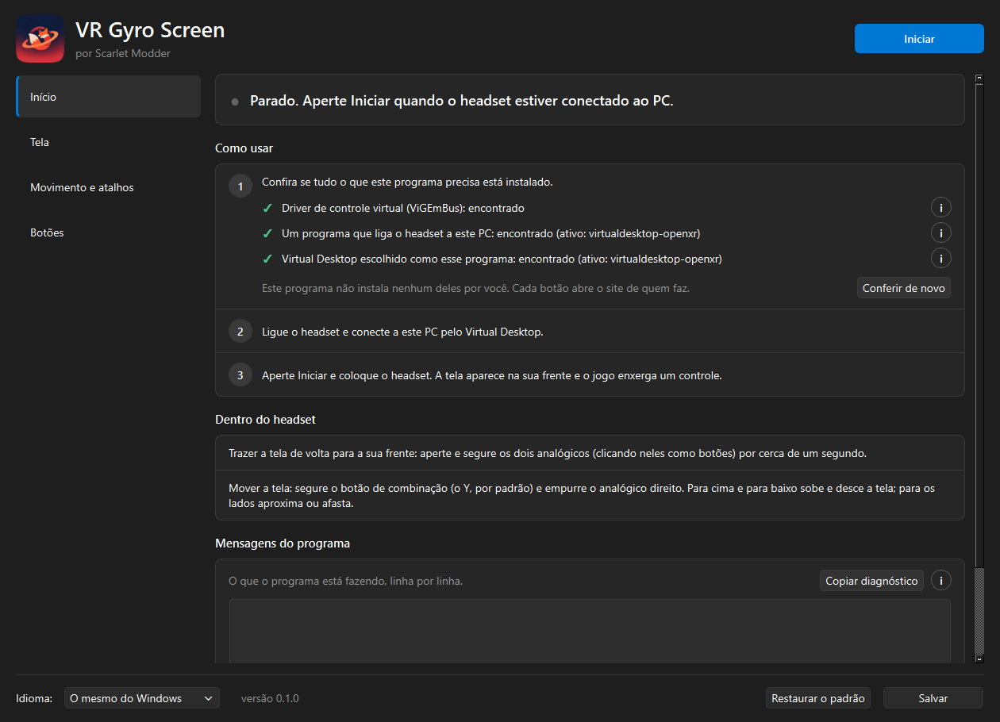
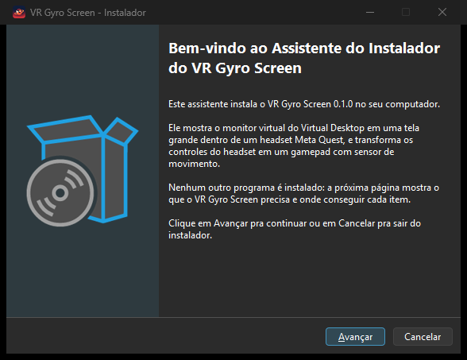
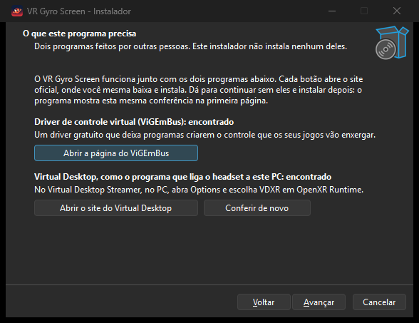
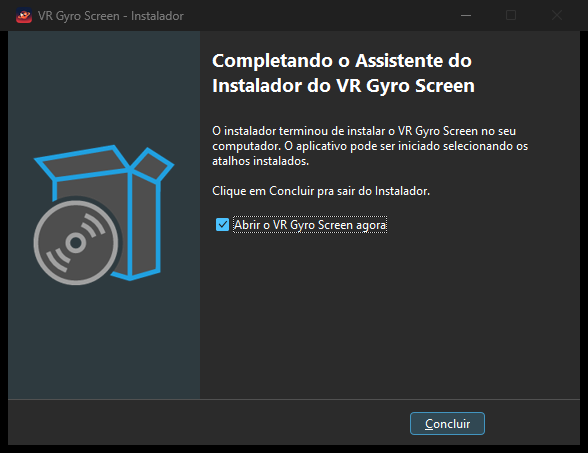
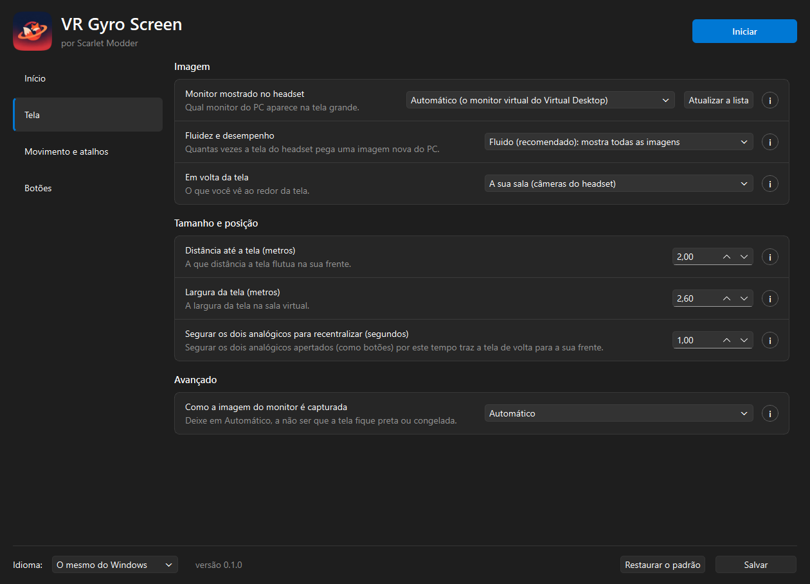
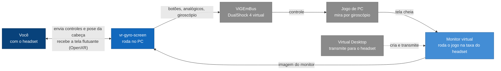

[English](README.md) | **Português**

<div align="center">

# 🎮 VR Gyro Screen

**Jogue os seus jogos de PC de tela plana favoritos numa tela gigante dentro do headset de VR, com os controles do headset nas mãos.**

O jogo aparece numa tela grande flutuando na sua frente, e os controles funcionam como um gamepad que também mira quando você mexe a mão.

[](#-o-que-você-precisa)
[](#-o-que-você-precisa)
[](https://www.vrdesktop.net)
[](README.md)
[](../../releases/latest)
[](LICENSE)
[](#%EF%B8%8F-estado-e-próximos-passos)

### [⬇️ Baixar a versão mais recente](../../releases/latest)

[O que você precisa](#-o-que-você-precisa) · [Instalar](#-baixar-e-instalar) · [Jogar](#-jogar-pela-primeira-vez) · [Deu problema?](#-se-algo-der-errado) · [Todos os guias](#-guias)



</div>

## 👋 O que é

O VR Gyro Screen é um programa gratuito para Windows. Você abre, aperta **Iniciar**, coloca o headset, e:

- **o jogo fica numa tela grande na sua frente**, flutuando na sua sala ou num espaço escuro, como você preferir;
- **os controles do headset viram um gamepad**, com todos os botões e os dois analógicos;
- **você mira mexendo a mão**, nos jogos que aceitam mira por movimento (também chamada de mira por giroscópio).

Ele é feito para jogos comuns de PC, aqueles que você jogaria num monitor. Ele não transforma esses jogos em jogos de VR: ele entrega uma tela enorme e um jeito confortável de segurar os controles.

Tudo se ajusta em uma janela só, em português ou inglês, e cada opção tem um botão **i** que explica em palavras simples o que ela faz.

## 🎯 Por que existe

Eu queria jogar jogos comuns de PC, de tela plana, dentro do meu headset de VR: uma tela enorme à minha frente e os controles do headset nas mãos. Também queria mirar apontando o controle para a tela, como faz um controle com sensores de movimento.

As opções prontas não me levavam até lá. O modo "controles como gamepad" do Virtual Desktop cria um controle **sem giroscópio**. Jogar pelo espelho da área de trabalho me limitava aos 60 Hz dos meus monitores físicos.

Então fiz este app.

## ✅ O que você precisa

| Você precisa de | O que é |
|---|---|
| Um PC com Windows 11 | Onde o jogo e este programa rodam |
| Um headset Meta Quest | O único headset testado até agora |
| [Virtual Desktop](https://www.vrdesktop.net) | O aplicativo que liga o headset ao PC. Vai no headset e no PC, e é feito por outra empresa |
| [ViGEmBus](https://github.com/nefarius/ViGEmBus/releases) | Um driver gratuito que deixa programas criarem um controle para os seus jogos |

Você não precisa conferir nada disso na mão. O instalador e o próprio programa mostram se cada item foi encontrado, e abrem o site oficial quando não foi.

## ⬇️ Baixar e instalar

1. Abra a [**versão mais recente**](../../releases/latest) e baixe o arquivo `VRGyroScreen-Setup-vX.Y.Z.exe`.
2. Rode o arquivo. Ele instala só para o seu usuário do Windows e não pede senha de administrador.

   

3. Uma página mostra o que o programa precisa e se cada item foi **encontrado**. Um botão abre o site oficial de cada um. O instalador não instala outros programas por você.

   

4. Na última página, aperte **Concluir**. O programa abre.

   

Para remover depois, use a lista de aplicativos instalados do Windows. Todas as páginas do instalador estão no [guia de uso](docs/usage.pt-BR.md).

## ▶️ Jogar pela primeira vez

> [!IMPORTANT]
> Duas coisas para desligar uma vez, senão os controles se comportam mal:
> - no Virtual Desktop, na aba **INPUT**, a opção **Use controllers as gamepad**;
> - nas configurações do headset, o **rastreamento de mãos**.

1. Ligue o headset e conecte ao PC pelo Virtual Desktop.
2. Abra o **VR Gyro Screen** pelo menu Iniciar.
3. Aperte **Iniciar** e coloque o headset. A tela aparece na sua frente.
4. Abra o seu jogo. Nas configurações de controle dele, ligue a **mira por giroscópio** (mira por movimento) se quiser mirar com a mão.
5. Quando terminar, aperte **Parar**, ou só feche a janela.

Dentro do headset:

- **Trazer a tela de volta para a sua frente:** aperte os dois analógicos para baixo (como botões) e segure por um segundo.
- **Mover a tela:** segure **Y** e empurre o analógico direito. Para cima e para baixo sobe e desce, para os lados aproxima e afasta.

O que cada botão faz, e como trocar, está no [guia de uso](docs/usage.pt-BR.md).



## 🩺 Se algo der errado

| O que acontece | O que fazer |
|---|---|
| O jogo joga sozinho | Desligue o rastreamento de mãos no headset |
| Os botões não fazem nada, ou o jogo vê dois controles | Desligue **Use controllers as gamepad** no Virtual Desktop |
| A tela está de lado | Aperte os dois analógicos para baixo e segure por 1 segundo |
| Mexer o controle não mexe a mira | Ligue a mira por giroscópio nas configurações de controle do jogo |
| O jogo engasga | Na página **Tela**, troque **Fluidez e desempenho** para **Leve** |

A lista completa está em [Solução de problemas](docs/troubleshooting.pt-BR.md). O botão **Copiar diagnóstico** da janela junta o que é preciso para pedir ajuda.

## 📚 Guias

| Guia | O que tem |
|---|---|
| [Uso](docs/usage.pt-BR.md) | Instalação passo a passo, todas as páginas da janela, os controles, o que conferir antes de jogar |
| [Configuração](docs/configuration.pt-BR.md) | Todas as opções e o que cada uma muda, mapeamento dos botões |
| [Solução de problemas](docs/troubleshooting.pt-BR.md) | O que pode dar errado, por quê, e o que fazer |
| [Arquitetura](docs/architecture.pt-BR.md) | Como o programa funciona por dentro, para quem desenvolve |
| [Avisos de terceiros](THIRD-PARTY-NOTICES.md) | As bibliotecas que o instalador leva e as licenças delas (em inglês) |

O VR Gyro Screen é gratuito e de código aberto, sob a [licença MIT](LICENSE) (texto em inglês).

---

# 🔧 Para quem tem curiosidade e para quem desenvolve

Daqui para baixo a página fica técnica. Você não precisa de nada disso para jogar.

## 🧩 Como funciona

O app faz duas coisas:

- mostra um monitor do Windows numa tela flutuante dentro do headset (por padrão o **monitor virtual** do Virtual Desktop, que roda na taxa de quadros do headset);
- transforma os controles do headset num **DualShock 4 virtual com giroscópio e acelerômetro**.



*Contexto: o que roda onde, e como a imagem e os controles viajam.*

## ✨ Funcionalidades

**Tela grande no headset**<br/>
Uma tela flutuante desenhada pelo compositor do headset (uma camada quad do OpenXR), então o texto fica nítido e o app não renderiza nada por olho. ✅ pronto

**Controle com sensor de movimento**<br/>
Os controles viram um DualShock 4 virtual com giroscópio e acelerômetro. A mão direita mira por padrão. ✅ pronto

**Captura barata**<br/>
Três backends de captura. O padrão mantém a imagem do monitor na placa de vídeo, sem cópia pelo processador. ✅ pronto

**Recentralizar a tela de três jeitos**<br/>
Segure os dois cliques dos analógicos, use o recentralizar do próprio headset ou faça o ajuste fino com uma tecla de combinação. ✅ pronto

**Dois perfis**<br/>
`smooth` (o padrão) mostra todas as imagens que o PC produz; `performance` deixa o máximo de força para o jogo. ✅ pronto

**Reconecta sozinho**<br/>
Quando o Virtual Desktop troca o monitor virtual, o app espera o novo e reabre a captura. ✅ pronto

**Janela de configuração**<br/>
Inicia e para com um botão, confere o que o app precisa e muda todas as opções do dia a dia em quatro páginas, em português ou inglês. ✅ pronto

**Instalador para Windows**<br/>
Instala só para o seu usuário, sem pedir administrador, em português ou inglês. Não instala nenhum programa de terceiros. ✅ pronto

## ⌨️ Pela linha de comando

A cópia instalada tem um programa de linha de comando, o `vr-gyro-screen-cli.exe`, na pasta de instalação. A partir do código-fonte você precisa de Python 3.11 ou mais novo:

```bash
git clone <a URL do repositório>
cd <a pasta clonada>
pip install .
vr-gyro-screen monitors
vr-gyro-screen
```

- `pip install .` também instala o driver ViGEmBus, pelo pacote `vgamepad`.
- Para o backend de captura opcional `dxcam`, use `pip install ".[dxcam]"`.

| Eu quero | Comando | O que acontece |
|---|---|---|
| Jogar | `vr-gyro-screen` | Mostra o monitor no headset e cria o controle |
| Abrir a janela de configuração | `vr-gyro-screen settings` | Abre a janela |
| Conferir o que o app precisa | `vr-gyro-screen check` | Diz se o driver e o runtime foram encontrados e se as bibliotecas do app carregam |
| Escolher um perfil | `vr-gyro-screen --profile performance` | Aplica `performance` ou `smooth` |
| Ver os monitores | `vr-gyro-screen monitors` | Lista e marca a escolha automática |
| Pôr um jogo no monitor do headset | `vr-gyro-screen window "parte do título"` | Move a janela para lá e põe em tela cheia |
| Medir o custo da captura | `vr-gyro-screen bench` | Compara os backends de captura, sem headset |

## ⚙️ Arquivo de configuração

A janela grava `%APPDATA%\vr-gyro-screen\config.toml`. Você também pode editar esse arquivo à mão: comece pelo [config.example.toml](config.example.toml), ou passe um arquivo com `--config`. Todas as opções, as faixas e o mapeamento dos botões estão em [docs/configuration.pt-BR.md](docs/configuration.pt-BR.md).

| Perfil | Imagens novas por segundo | Use quando |
|---|---|---|
| `smooth` (padrão) | todas as que o PC produz | Sempre, a não ser que o jogo engasgue: a tela fica tão fluida quanto o jogo e o headset permitem |
| `performance` | no máximo 60 | O jogo precisa de toda a força: deixa o máximo para ele |

## 🏗️ Arquitetura

O app tem duas partes. A janela de configuração é um processo. Quando você aperta **Iniciar**, ela roda o motor como um segundo processo e lê as mensagens dele. O motor tem um só laço: lê os controles, escreve um relatório de controle e traz a imagem mais nova do monitor para o headset. O quadro completo, com os estados da captura, o modelo de movimento e o instalador, está em [docs/architecture.pt-BR.md](docs/architecture.pt-BR.md).

## 🗺️ Estado e próximos passos

> [!NOTE]
> O projeto é experimental. Foi testado em um ambiente (Meta Quest, Virtual Desktop, o runtime OpenXR dele). Outros headsets e outros runtimes OpenXR **não foram testados**.

| Área | Estado |
|---|---|
| Tela no headset, controle com movimento, recentralizar | ✅ pronto, validado em uso real em um ambiente |
| Janela de configuração e instalador, nas duas línguas | ✅ pronto |
| Meta Quest com Virtual Desktop e o runtime OpenXR dele | ✅ validado a 90 quadros por segundo |
| Outros headsets e outros runtimes OpenXR | 🧪 não testado |
| Outras placas de vídeo | 🧪 não testado |

## 🤝 Contribuição

Instale as ferramentas de desenvolvimento com `pip install -e ".[dev]"`. As checagens que rodam a cada push são `ruff check .`, `ruff format --check .`, `mypy` e `python -m pytest`. Os testes cobrem a lógica que não precisa de headset nem de driver.

Para gerar o instalador, rode `scripts\build.ps1` no PowerShell. Ele precisa do PyInstaller e do Inno Setup 6.3 ou mais novo. O resultado é `dist\VRGyroScreen-Setup-vX.Y.Z.exe` e um arquivo `SHA256SUMS.txt` com a soma de verificação dele. Como isso funciona está em [docs/architecture.pt-BR.md](docs/architecture.pt-BR.md).
