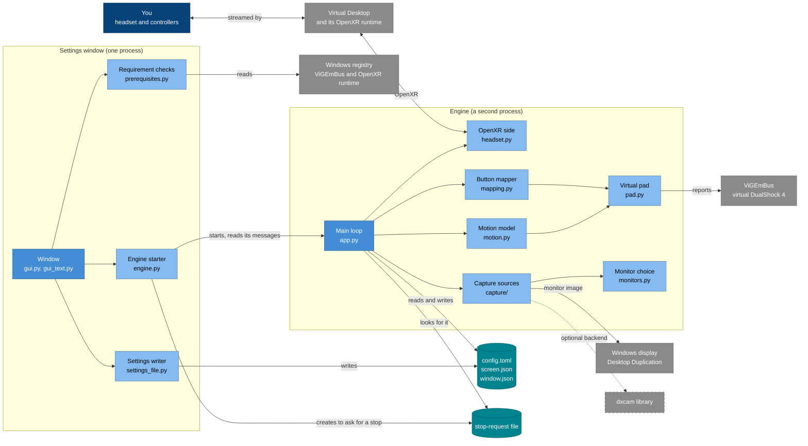
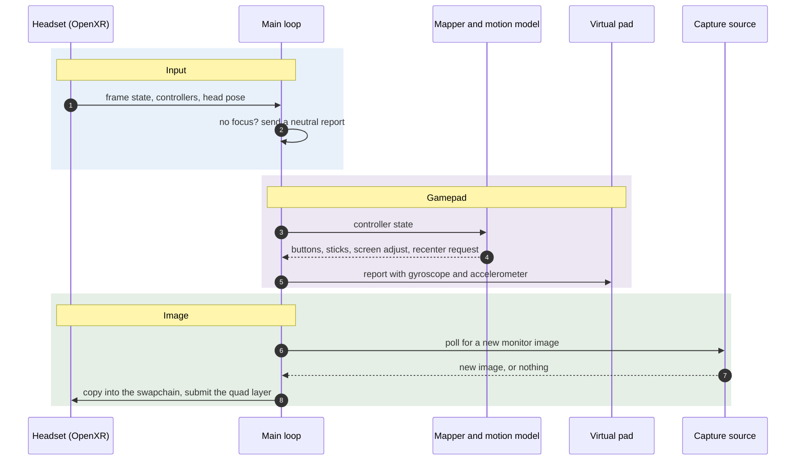
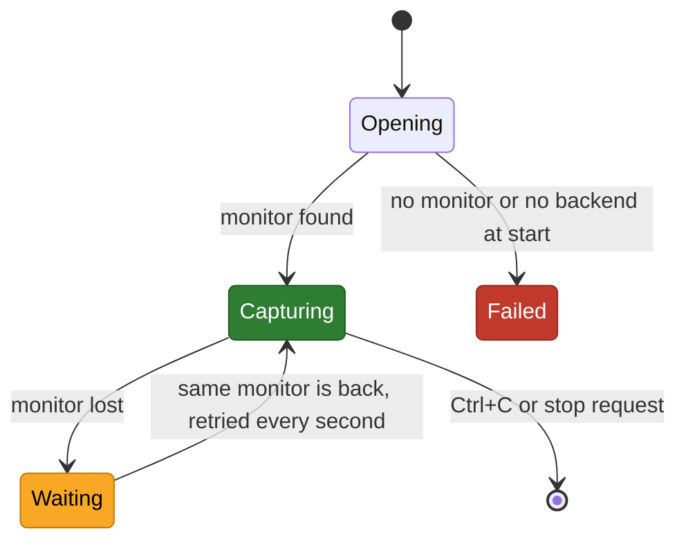
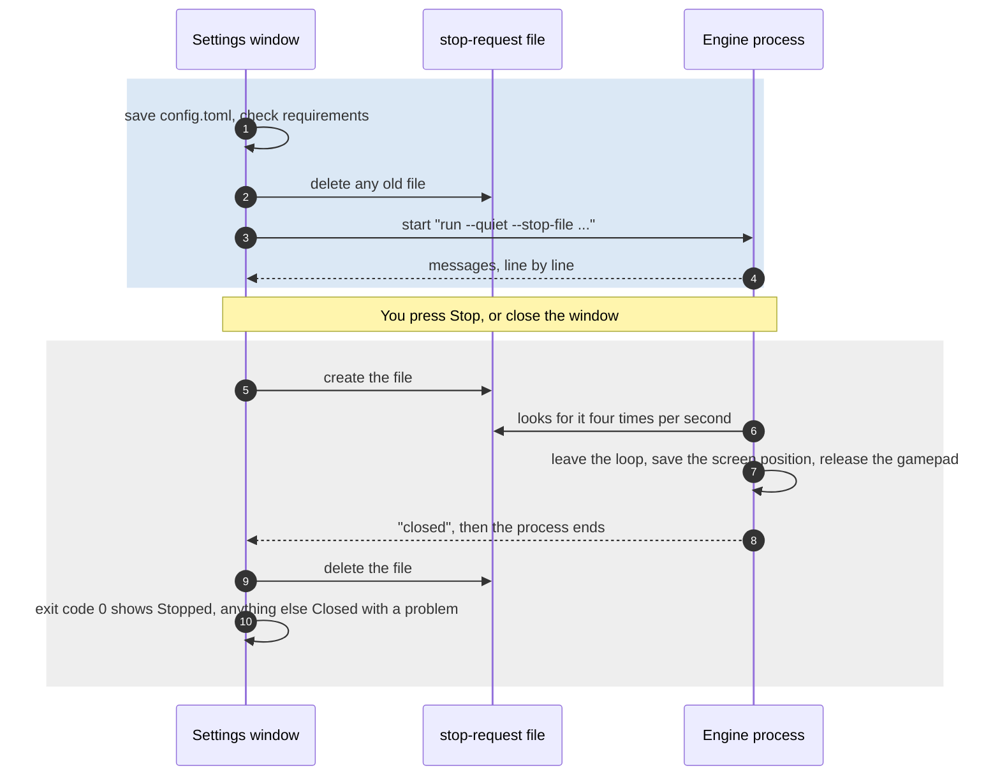

**English** | [Português](architecture.pt-BR.md)

# 🏗️ Architecture

The app has two parts, each in its own Windows process. The **settings window** is what you open from the Start menu. The **engine** is the part that talks to the headset: one loop, tied to the headset frame rate. In each turn it reads the controllers, writes one report to a virtual gamepad, and brings the newest monitor image to the headset. The window starts the engine when you press **Start** and asks it to stop when you press **Stop**.

This page shows the pieces, the path of one frame, the states of the capture, how the window and the engine work together, how the program is packed and installed, and the reasons behind the main design choices. Back to the [README](../README.md).

## 🧱 Pieces

**Containers: what each process is made of and what it talks to.**



| Module | Responsibility |
|---|---|
| `app.py` | The engine loop: focus handling, placement, capture polling, timing report, passthrough background, the stop file |
| `headset.py` | Reads both controllers and the head pose; draws the screen as a quad layer; watches the headset's own recenter |
| `placement.py` | Where the screen floats (arc, height, distance) and the file that remembers it |
| `mapping.py` | Turns controller state into gamepad buttons, directional pad, the combination key and the recenter hold |
| `motion.py` | Turns the hand pose into gyroscope and accelerometer values |
| `pad.py` | Writes the virtual DualShock 4 report (buttons, sticks, triggers, motion, timestamp) |
| `capture/` | Desktop Duplication through plain `ctypes`, and the three frame sources |
| `monitors.py` | Lists Windows monitors and chooses the one for the headset |
| `config.py` | Defaults, TOML file, profiles, validation |
| `gui.py` | The settings window: four pages, the **Start** and **Stop** button, the requirement checklist, the messages, the language choice |
| `gui_text.py` | Every text of the window, in English and in Brazilian Portuguese, and the choice of language |
| `engine.py` | Starts the engine as a separate process, reads its output, asks it to stop |
| `settings_file.py` | Writes a configuration back to a TOML file |
| `prerequisites.py` | Checks that ViGEmBus and the Virtual Desktop OpenXR runtime are present, and says where to get them |
| `window.py`, `bench.py`, `cli.py` | The `window` and `bench` helpers and the command line (`run`, `settings`, `check`, `monitors`, `window`, `bench`) |

## 🔁 One frame

**Sequence: what happens in each turn of the engine loop.**



When the session has no focus (for example, the headset menu is open), the loop sends a neutral report so no button stays pressed.

## 🔄 Capture states

**States: what happens to the capture when the virtual monitor goes away.**



At start-up, a problem is fatal and explained (`could not capture the monitor: ...`). After a loss, the app accepts only the same monitor again. A virtual monitor comes back under a new Windows name, so the description decides; when several monitors share that description, the name or the place on the desktop must also match. Falling back to another monitor would put a different desktop in the headset without anyone asking.

## 🪟 Window and engine

The window is built with Qt for Python (PySide6). It does not talk to the headset itself. When you press **Start**, it first saves the settings and checks the requirements, then starts the engine with this command:

```text
vr-gyro-screen-cli.exe run --quiet --stop-file %APPDATA%\vr-gyro-screen\stop-request
```

In the installed copy, `vr-gyro-screen-cli.exe` sits next to the window program. From the source code, the same arguments go to `python -u -m vr_gyro_screen`. The engine opens with no console window of its own. A background thread reads everything it prints, and the window shows those lines in its messages area, checking ten times per second.

**Sequence: Start and Stop.**



Why a separate process:

- The window stays responsive while the engine runs its loop at the headset rate.
- If the headset session fails, the engine ends with a message. The window stays open and shows that message, so you can read it and copy it.

Why a stop file: on Windows, a process ended from outside gets no chance to release the gamepad buttons. The engine checks for the file every 0.25 seconds and, when it appears, leaves its loop the normal way. If the engine has not ended 5 seconds after the request, the window ends it by force, as a last resort. Closing the window while the engine runs sends the same request; the window closes when the engine is done.

Other details of the window:

- **One window at a time.** The window holds a named Windows lock (a mutex called `VRGyroScreenWindow`). Opening the program again finds the lock and brings the open window to the front. The installer looks for the same lock to ask you to close the window before it changes the files.
- **Language.** The texts live in `gui_text.py`. The window uses the language saved in `window.json`; with no choice saved, Portuguese when Windows is in Portuguese, and English otherwise. The `VR_GYRO_SCREEN_LANG` environment variable (`en` or `pt`) forces one. Changing the language rebuilds the window and keeps what was typed and not saved yet. It cannot change while the engine runs.
- **The "i" button.** Each option has a help text. Its first sentence always shows under the option name; the rest opens with the **i** button next to it, and also shows as a tooltip.
- **Validation.** Before saving, the window turns its fields into the same document the file would hold and runs the same checks the file gets when it is read. A value the engine would refuse is never saved.

## 💾 Settings file

`settings_file.py` writes the configuration back to `config.toml`. The Python standard library reads TOML but does not write it. The configuration only uses text, numbers, true or false and tables of those, so a small writer is enough.

- Only what differs from the built-in defaults is written. The file stays short and keeps following the defaults of later versions.
- `capture.mipmaps` and `capture.max_fps` are compared with the chosen profile, not with the general defaults.
- A file you wrote by hand is copied to `config.toml.bak` before the window replaces it; a file the window wrote itself is just replaced, so your copy is not lost. The new text goes to `config.toml.new` first and then replaces the old file in one step, so a failure halfway never leaves a broken file.

## ✅ Requirement checks

`prerequisites.py` reads two places in the Windows registry (the database where Windows and installed programs keep their settings), under `HKEY_LOCAL_MACHINE`:

| Check | Where | Counts as found when |
|---|---|---|
| Virtual gamepad driver | `SYSTEM\CurrentControlSet\Services\ViGEmBus`, value `ImagePath` | The value exists |
| OpenXR runtime | `SOFTWARE\Khronos\OpenXR\1`, value `ActiveRuntime` | The value exists |
| Virtual Desktop as that runtime | The same value | The file name of the active runtime contains "virtualdesktop" |

Nothing is installed from here. Each missing item points to the official site: the ViGEmBus releases page or the Virtual Desktop site. The window, the `check` command and the installer show the same checks (the installer does its own reading of the same registry values).

`check` also tries to load the libraries the engine needs (`xr`, `glfw`, `OpenGL.GL`, `vgamepad`). It ends with an error code only when one of them fails. A missing driver or runtime is printed but does not count as a failure. The build script relies on this: only a library that does not load stops the build.

## 📦 Packaging and installer

The installed copy needs no Python on the computer. Three files build it:

**`packaging/vr-gyro-screen.spec`** is the recipe for PyInstaller, a tool that packs a Python program and everything it needs into ordinary Windows programs. It makes one folder with two programs that share the same files:

| Program | What it is |
|---|---|
| `vr-gyro-screen.exe` | The settings window, with no console. If it fails at start, it shows the error in a message box |
| `vr-gyro-screen-cli.exe` | The engine and the command line, with a console. It takes the same commands as `vr-gyro-screen` |

The recipe collects only the libraries the programs load. It leaves out on purpose the ViGEmBus installer that comes inside the `vgamepad` package: drivers are installed by the person, from the site of whoever makes them. It also leaves out the optional `dxcam` library, so the `dxcam` capture backend is not available in the installed copy.

**`scripts/build.ps1`** builds everything, in this order:

1. Reads the version from `pyproject.toml`.
2. Runs PyInstaller with the recipe. The result goes to `work\dist\vr-gyro-screen` (`work\` is not versioned).
3. Runs `vr-gyro-screen-cli.exe check` on that folder. The build stops if a library of the packed copy does not load.
4. Runs Inno Setup (6.7 or newer), the tool that makes the installer, with `installer/vr-gyro-screen.iss`.
5. Leaves `dist\VRGyroScreen-Setup-vX.Y.Z.exe` and `dist\SHA256SUMS.txt`, with the checksum of the installer. Older installers in `dist\` are deleted first, so nobody picks one by mistake.

**`installer/vr-gyro-screen.iss`** describes the installer:

- It installs for the current user only and asks for no administrator rights, because the program needs none.
- It speaks English or Brazilian Portuguese.
- A page, **What this program needs**, shows ViGEmBus and Virtual Desktop, says whether each one was found, has a button to the official site of each and a **Check again** button. It installs neither of them.
- It creates a shortcut in the Start menu, and a desktop shortcut only if you ask for one. It copies `THIRD-PARTY-NOTICES.md` and the license (`LICENSE.txt`) to the installation folder.
- When uninstalling, it removes the program and asks whether to remove `%APPDATA%\vr-gyro-screen` too. The settings are the person's, so they only go away when the person says so; **No** is the answer already selected.

[THIRD-PARTY-NOTICES.md](../THIRD-PARTY-NOTICES.md) lists the libraries the installer carries, what each one is for and its license.

## 🖼️ Image path

- **Quad layer.** The screen is an OpenXR quad layer. The headset compositor draws it at the display's resolution, so text stays sharp, and the app renders nothing per eye (`headset.py`, `ScreenLayer`).
- **Mipmaps.** The 2560 pixel wide monitor covers fewer pixels in the headset. Reduced copies keep fine detail from shimmering, but building them for every image costs the graphics card bursts longer than a frame, so they are off by default (`capture.mipmaps`). If the runtime refuses the levels, the app continues without them.
- **Flip on the graphics card.** The stored image has its top row first, which OpenGL reads upside down. The copy into the swapchain swaps the destination rows, so the flip costs the processor nothing.
- **Background.** Passthrough when the runtime offers it to apps, otherwise black. Passthrough needs a projection layer with transparent pixels behind the screen.

### Capture backends

| Backend | Path |
|---|---|
| `gpu` | The duplicated image is a Direct3D texture shared with OpenGL (`WGL_NV_DX_interop2`). No copy through the processor |
| `direct` | One copy through system memory per new image, no helper threads |
| `dxcam` | A background thread and several copies per image. Kept as a fallback and for comparison. Not in the installed copy |

The shared texture stays in the plain (not sRGB) format. With the sRGB format the copy came out darker in a measurement (a value of 117 became 45). Measured costs are in [configuration](configuration.md).

## 🎯 Motion model

Games that support motion aiming usually fuse the gyroscope and the accelerometer: the gyroscope moves the aim and gravity slowly corrects the drift. If the two disagree, the game pulls the aim back or ignores part of the movement.

Two simpler models failed that way, and the one in use avoids both:

| Model | What went wrong |
|---|---|
| Gravity fixed as "controller lying flat" | The aim crept back whenever the hand was raised |
| Virtual orientation integrated from the gyroscope | It drifted and killed the sideways aim |
| **In use:** a "player frame" from the real heading and pitch of the hand, roll forced to zero | The gyroscope is the time derivative of the very angles that produce the gravity vector, so both sensors tell the same story |

Details in `motion.py`:

- A dead zone (1.5 degrees per second by default) hides the jitter of a still hand.
- A jump above 1500 degrees per second is a tracking jump, and is discarded.
- Each sample is blended 50% with the previous one to hide pose prediction jitter.
- When the hand is nearly vertical (beyond 80 degrees of pitch) the heading is noise and is ignored.
- A gyroscope that repeats the exact same value makes some games restart their motion sensor. The app adds one raw unit of alternating sign, with zero average.
- Raw units follow the DualShock 4: 16 per degree per second for the gyroscope, 8192 per g for the accelerometer.

## 📐 Decisions

| Decision | Why |
|---|---|
| The engine is one process with one loop and no helper threads (except the optional `dxcam` backend) | Capture, input and output share the same timing, so the loop can report late frames and capture time |
| The window and the engine run in separate processes | The window stays responsive, and a failure in the headset session becomes a message in the window instead of closing it |
| The window asks the engine to stop through a file | On Windows, a process ended from outside gets no chance to release the gamepad buttons. Ending by force is only the last resort, after 5 seconds |
| The window saves through the same checks as the file | A value the engine would refuse never reaches the file |
| The installer installs no third-party program | Drivers and the headset software are installed by the person, from the site of whoever makes them. The installer only says what was found and where to get the rest |
| Installation per user | The program needs no administrator rights, so the installer asks for none |
| Controller bindings for the Touch controller profile only | The app suggests bindings for one OpenXR interaction profile |
| Check only whether each input is "active" | Checking which interaction profile is bound was tried, to mute hand tracking pinches, and it silenced real controllers on some runtimes. Turning hand tracking off in the headset is the reliable fix |
| Watch the OpenXR reference space change event | The headset's own recenter moves the origin of the tracking space. The helper loop of the OpenXR binding drops that event, so the poll function is wrapped to catch it |
| Mapping and shortcuts are data | Validated when the configuration loads, so a typo is reported before the headset is on |

## 🧭 Coverage

What this page rests on: a reading of the code in `src/vr_gyro_screen/`, `packaging/`, `scripts/build.ps1` and `installer/vr-gyro-screen.iss`, and the measurements from the first validation. Not verified: other headsets, other OpenXR runtimes, other graphics cards, and the cost of the new capture at 1440p and 90 Hz inside the headset.
