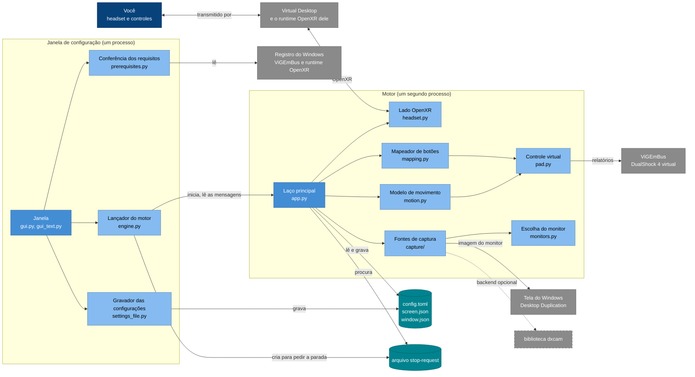
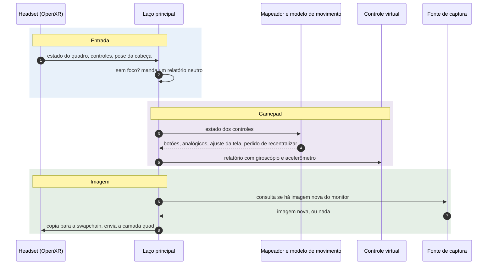
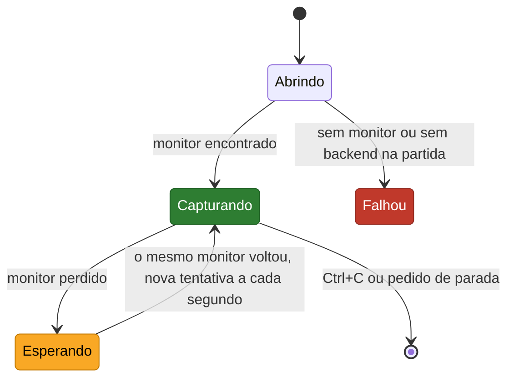
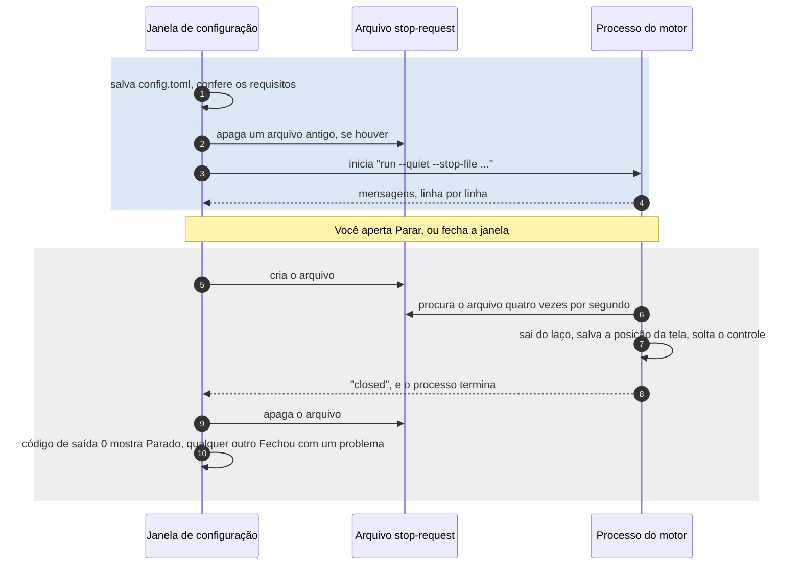

[English](architecture.md) | **Português**

# 🏗️ Arquitetura

O app tem duas partes, cada uma no seu próprio processo do Windows. A **janela de configuração** é o que você abre pelo menu Iniciar. O **motor** é a parte que conversa com o headset: um laço, preso à taxa de quadros do headset. A cada volta ele lê os controles, escreve um relatório num gamepad virtual e traz a imagem mais nova do monitor para o headset. A janela inicia o motor quando você aperta **Iniciar** e pede que ele pare quando você aperta **Parar**.

Esta página mostra as peças, o caminho de um quadro, os estados da captura, como a janela e o motor trabalham juntos, como o programa é empacotado e instalado, e as razões por trás das principais escolhas de projeto. Voltar ao [README](../README.pt-BR.md).

## 🧱 Peças

**Contêineres: do que cada processo é feito e com quem conversa.**



| Módulo | Responsabilidade |
|---|---|
| `app.py` | O laço do motor: tratamento de foco, posicionamento, leitura da captura, relatório de tempos, fundo de passthrough, o arquivo de parada |
| `headset.py` | Lê os dois controles e a pose da cabeça; desenha a tela como camada quad; vigia o recentralizar do próprio headset |
| `placement.py` | Onde a tela flutua (arco, altura, distância) e o arquivo que guarda isso |
| `mapping.py` | Transforma o estado dos controles em botões do gamepad, direcional, tecla de combinação e o segurar do recentralizar |
| `motion.py` | Transforma a pose da mão em valores de giroscópio e acelerômetro |
| `pad.py` | Escreve o relatório do DualShock 4 virtual (botões, analógicos, gatilhos, movimento, marca de tempo) |
| `capture/` | Desktop Duplication com `ctypes` puro, e as três fontes de imagem |
| `monitors.py` | Lista os monitores do Windows e escolhe o do headset |
| `config.py` | Padrões, arquivo TOML, perfis, validação |
| `gui.py` | A janela de configuração: quatro páginas, o botão **Iniciar** e **Parar**, a conferência dos requisitos, as mensagens, a escolha de idioma |
| `gui_text.py` | Todos os textos da janela, em inglês e em português do Brasil, e a escolha do idioma |
| `engine.py` | Inicia o motor como um processo separado, lê o que ele imprime, pede que ele pare |
| `settings_file.py` | Grava uma configuração de volta num arquivo TOML |
| `prerequisites.py` | Confere se o ViGEmBus e o runtime OpenXR do Virtual Desktop estão presentes, e diz onde conseguir cada um |
| `window.py`, `bench.py`, `cli.py` | Os auxiliares `window` e `bench` e a linha de comando (`run`, `settings`, `check`, `monitors`, `window`, `bench`) |

## 🔁 Um quadro

**Sequência: o que acontece em cada volta do laço do motor.**



Quando a sessão não tem foco (por exemplo, o menu do headset está aberto), o laço manda um relatório neutro para nenhum botão ficar preso.

## 🔄 Estados da captura

**Estados: o que acontece com a captura quando o monitor virtual some.**



Na partida, um problema é fatal e explicado (`could not capture the monitor: ...`). Depois de uma perda, o app só aceita de volta o mesmo monitor. Um monitor virtual volta com outro nome no Windows, então quem decide é a descrição; quando vários monitores têm a mesma descrição, o nome ou o lugar na área de trabalho também precisa bater. Cair para outro monitor poria uma área de trabalho diferente no headset sem ninguém pedir.

## 🪟 Janela e motor

A janela é feita com Qt para Python (PySide6). Ela não conversa com o headset. Quando você aperta **Iniciar**, ela primeiro salva as configurações e confere os requisitos, depois inicia o motor com este comando:

```text
vr-gyro-screen-cli.exe run --quiet --stop-file %APPDATA%\vr-gyro-screen\stop-request
```

Na cópia instalada, o `vr-gyro-screen-cli.exe` fica ao lado do programa da janela. A partir do código-fonte, os mesmos argumentos vão para `python -u -m vr_gyro_screen`. O motor abre sem janela de console própria. Uma thread em segundo plano lê tudo o que ele imprime, e a janela mostra essas linhas na área de mensagens, olhando dez vezes por segundo.

**Sequência: Iniciar e Parar.**



Por que um processo separado:

- A janela continua respondendo enquanto o motor roda o laço na taxa do headset.
- Se a sessão do headset falhar, o motor termina com uma mensagem. A janela continua aberta e mostra essa mensagem, para você ler e copiar.

Por que um arquivo de parada: no Windows, um processo encerrado de fora não tem chance de soltar os botões do controle virtual. O motor procura o arquivo a cada 0,25 segundo e, quando ele aparece, sai do laço pelo caminho normal. Se o motor não terminar 5 segundos depois do pedido, a janela o encerra à força, como último recurso. Fechar a janela com o motor rodando manda o mesmo pedido; a janela fecha quando o motor termina.

Outros detalhes da janela:

- **Uma janela por vez.** A janela segura uma trava com nome no Windows (um mutex chamado `VRGyroScreenWindow`). Abrir o programa de novo encontra a trava e traz para a frente a janela que já está aberta. O instalador procura a mesma trava para pedir que você feche a janela antes de mexer nos arquivos.
- **Idioma.** Os textos ficam em `gui_text.py`. A janela usa o idioma salvo em `window.json`; sem escolha salva, português quando o Windows está em português, e inglês nos outros casos. A variável de ambiente `VR_GYRO_SCREEN_LANG` (`en` ou `pt`) força um deles. Trocar o idioma refaz a janela e mantém o que foi preenchido e ainda não salvo. Não dá para trocar com o motor rodando.
- **O botão "i".** Cada opção tem um texto de ajuda. A primeira frase sempre aparece embaixo do nome da opção; o resto abre com o botão **i** ao lado, e também aparece como dica quando o mouse para em cima.
- **Validação.** Antes de salvar, a janela transforma os campos no mesmo documento que o arquivo teria e passa pelas mesmas conferências que o arquivo recebe ao ser lido. Um valor que o motor recusaria nunca é salvo.

## 💾 Arquivo de configurações

O `settings_file.py` grava a configuração de volta no `config.toml`. A biblioteca padrão do Python lê TOML, mas não escreve. A configuração só usa texto, números, verdadeiro ou falso e tabelas disso, então um gravador pequeno basta.

- Só entra o que for diferente dos padrões do programa. O arquivo fica curto e continua seguindo os padrões das próximas versões.
- `capture.mipmaps` e `capture.max_fps` são comparados com o perfil escolhido, não com os padrões gerais.
- Um arquivo que você escreveu à mão é copiado para `config.toml.bak` antes de a janela substituí-lo; um arquivo que a própria janela gravou é só substituído, então a sua cópia não se perde. O texto novo vai primeiro para `config.toml.new` e depois substitui o antigo de uma vez, então uma falha no meio nunca deixa um arquivo quebrado.

## ✅ Conferência dos requisitos

O `prerequisites.py` lê dois lugares do registro do Windows (o banco de dados onde o Windows e os programas instalados guardam as configurações deles), em `HKEY_LOCAL_MACHINE`:

| Conferência | Onde | Conta como encontrado quando |
|---|---|---|
| Driver de controle virtual | `SYSTEM\CurrentControlSet\Services\ViGEmBus`, valor `ImagePath` | O valor existe |
| Runtime OpenXR | `SOFTWARE\Khronos\OpenXR\1`, valor `ActiveRuntime` | O valor existe |
| Virtual Desktop como esse runtime | O mesmo valor | O nome do arquivo do runtime ativo contém "virtualdesktop" |

Nada é instalado por aqui. Cada item que falta aponta para o site oficial: a página de versões do ViGEmBus ou o site do Virtual Desktop. A janela, o comando `check` e o instalador mostram as mesmas conferências (o instalador faz a própria leitura dos mesmos valores do registro).

O `check` também tenta carregar as bibliotecas de que o motor precisa (`xr`, `glfw`, `OpenGL.GL`, `vgamepad`). Ele só termina com código de erro quando uma delas falha. Um driver ou runtime ausente aparece na saída, mas não conta como falha. O script de geração depende disso: só uma biblioteca que não carrega interrompe a geração.

## 📦 Empacotamento e instalador

A cópia instalada não precisa de Python no computador. Três arquivos a montam:

**`packaging/vr-gyro-screen.spec`** é a receita do PyInstaller, uma ferramenta que junta um programa Python e tudo de que ele precisa em programas comuns do Windows. Ela gera uma pasta com dois programas que compartilham os mesmos arquivos:

| Programa | O que é |
|---|---|
| `vr-gyro-screen.exe` | A janela de configuração, sem console. Se falhar ao abrir, mostra o erro numa caixa de mensagem |
| `vr-gyro-screen-cli.exe` | O motor e a linha de comando, com console. Aceita os mesmos comandos do `vr-gyro-screen` |

A receita junta só as bibliotecas que os programas carregam. Ela deixa de fora de propósito o instalador do ViGEmBus que vem dentro do pacote `vgamepad`: driver é a pessoa quem instala, pelo site de quem faz. Ela também deixa de fora a biblioteca opcional `dxcam`, então o backend de captura `dxcam` não existe na cópia instalada.

**`scripts/build.ps1`** gera tudo, nesta ordem:

1. Lê a versão do `pyproject.toml`.
2. Roda o PyInstaller com a receita. O resultado vai para `work\dist\vr-gyro-screen` (`work\` não é versionado).
3. Roda `vr-gyro-screen-cli.exe check` nessa pasta. A geração para se alguma biblioteca da cópia empacotada não carregar.
4. Roda o Inno Setup (6.7 ou mais novo), a ferramenta que monta o instalador, com o `installer/vr-gyro-screen.iss`.
5. Deixa `dist\VRGyroScreen-Setup-vX.Y.Z.exe` e `dist\SHA256SUMS.txt`, com a soma de verificação do instalador. Instaladores antigos em `dist\` são apagados antes, para ninguém pegar um deles por engano.

**`installer/vr-gyro-screen.iss`** descreve o instalador:

- Instala só para o usuário atual e não pede administrador, porque o programa não precisa.
- Fala inglês ou português do Brasil.
- Uma página, **O que este programa precisa**, mostra o ViGEmBus e o Virtual Desktop, diz se cada um foi encontrado, tem um botão para o site oficial de cada um e um botão **Conferir de novo**. Não instala nenhum dos dois.
- Cria um atalho no menu Iniciar, e um atalho na área de trabalho só se você pedir. Copia o `THIRD-PARTY-NOTICES.md` e a licença (`LICENSE.txt`) para a pasta de instalação.
- Ao desinstalar, remove o programa e pergunta se remove também `%APPDATA%\vr-gyro-screen`. As configurações são da pessoa, então só saem quando ela disser; **Não** é a resposta que já vem marcada.

O [THIRD-PARTY-NOTICES.md](../THIRD-PARTY-NOTICES.md) lista as bibliotecas que o instalador leva, para que serve cada uma e a licença dela.

## 🖼️ Caminho da imagem

- **Camada quad.** A tela é uma camada quad do OpenXR. O compositor do headset a desenha na resolução do visor, então o texto fica nítido, e o app não renderiza nada por olho (`headset.py`, `ScreenLayer`).
- **Mipmaps.** O monitor de 2560 pixels de largura cobre menos pixels no headset. As cópias reduzidas evitam que o detalhe fino cintile, mas prepará-las a cada imagem custa à placa de vídeo rajadas mais longas que um quadro, então ficam desligadas por padrão (`capture.mipmaps`). Se o runtime recusar os níveis, o app continua sem eles.
- **Inversão na placa de vídeo.** A imagem guardada tem a linha de cima primeiro, que o OpenGL lê de cabeça para baixo. A cópia para a swapchain troca as linhas de destino, então a inversão não custa nada ao processador.
- **Fundo.** Passthrough quando o runtime o oferece a apps, senão preto. O passthrough precisa de uma camada de projeção com pixels transparentes atrás da tela.

### Backends de captura

| Backend | Caminho |
|---|---|
| `gpu` | A imagem duplicada é uma textura Direct3D compartilhada com o OpenGL (`WGL_NV_DX_interop2`). Sem cópia pelo processador |
| `direct` | Uma cópia pela memória do sistema a cada imagem nova, sem threads auxiliares |
| `dxcam` | Uma thread em segundo plano e várias cópias por imagem. Mantido como reserva e para comparação. Não vem na cópia instalada |

A textura compartilhada fica no formato simples (não sRGB). Com o formato sRGB a cópia saiu mais escura numa medição (o valor 117 virou 45). Os custos medidos estão na [configuração](configuration.pt-BR.md).

## 🎯 Modelo de movimento

Jogos com mira por movimento costumam fundir o giroscópio e o acelerômetro: o giroscópio move a mira e a gravidade corrige devagar a deriva. Se os dois discordam, o jogo puxa a mira de volta ou ignora parte do movimento.

Dois modelos mais simples falharam desse jeito, e o que está em uso evita os dois:

| Modelo | O que deu errado |
|---|---|
| Gravidade fixa de "controle deitado" | A mira voltava sozinha sempre que a mão era erguida |
| Orientação virtual integrada a partir do giroscópio | Derivava e matava a mira lateral |
| **Em uso:** um "referencial do jogador" com o rumo e a inclinação reais da mão, rolagem forçada a zero | O giroscópio é a derivada no tempo dos mesmos ângulos que produzem o vetor da gravidade, então os dois sensores contam a mesma história |

Detalhes em `motion.py`:

- Uma zona morta (1,5 grau por segundo por padrão) esconde a tremedeira de uma mão parada.
- Um salto acima de 1500 graus por segundo é um salto de rastreamento e é descartado.
- Cada amostra é misturada 50% com a anterior para esconder o tremor da predição de pose.
- Com a mão quase vertical (além de 80 graus de inclinação) o rumo é ruído e é ignorado.
- Um giroscópio que repete exatamente o mesmo valor faz alguns jogos reiniciarem o sensor de movimento. O app soma uma unidade crua de sinal alternado, com média zero.
- As unidades cruas seguem o DualShock 4: 16 por grau por segundo no giroscópio, 8192 por g no acelerômetro.

## 📐 Decisões

| Decisão | Por quê |
|---|---|
| O motor é um processo com um laço e sem threads auxiliares (exceto o backend opcional `dxcam`) | Captura, entrada e saída compartilham o mesmo tempo, então o laço pode relatar quadros atrasados e o tempo de captura |
| A janela e o motor rodam em processos separados | A janela continua respondendo, e uma falha na sessão do headset vira mensagem na janela em vez de fechá-la |
| A janela pede a parada do motor por um arquivo | No Windows, um processo encerrado de fora não tem chance de soltar os botões do controle virtual. Encerrar à força é só o último recurso, depois de 5 segundos |
| A janela salva passando pelas mesmas conferências do arquivo | Um valor que o motor recusaria nunca chega ao arquivo |
| O instalador não instala programas de terceiros | Driver e o software do headset são instalados pela pessoa, pelo site de quem faz. O instalador só diz o que foi encontrado e onde conseguir o resto |
| Instalação por usuário | O programa não precisa de administrador, então o instalador não pede |
| Associações só para o perfil de controle Touch | O app sugere associações para um único perfil de interação do OpenXR |
| Conferir só se cada entrada está "ativa" | Conferir qual perfil de interação está associado foi tentado, para silenciar as pinças do rastreamento de mãos, e silenciou controles de verdade em alguns runtimes. Desligar o rastreamento de mãos no headset é a correção confiável |
| Vigiar o evento de mudança do espaço de referência do OpenXR | O recentralizar do próprio headset move a origem do espaço de rastreamento. O laço auxiliar da biblioteca OpenXR descarta esse evento, então a função de consulta é envolvida para pegá-lo |
| Mapeamento e atalhos são dados | Validados quando a configuração carrega, então um erro de digitação aparece antes de o headset estar ligado |

## 🧭 Cobertura

No que esta página se apoia: a leitura do código em `src/vr_gyro_screen/`, `packaging/`, `scripts/build.ps1` e `installer/vr-gyro-screen.iss`, e as medições da primeira validação. Não verificado: outros headsets, outros runtimes OpenXR, outras placas de vídeo e o custo da captura nova a 1440p e 90 Hz dentro do headset.
