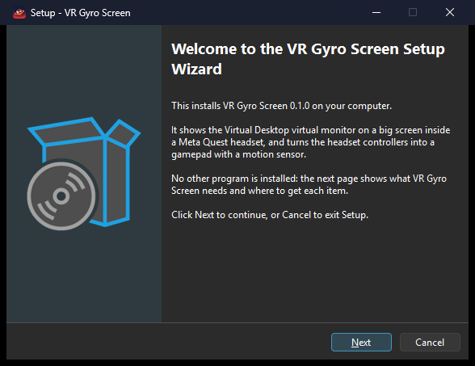
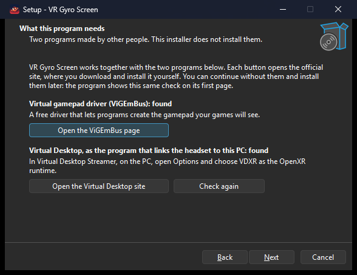
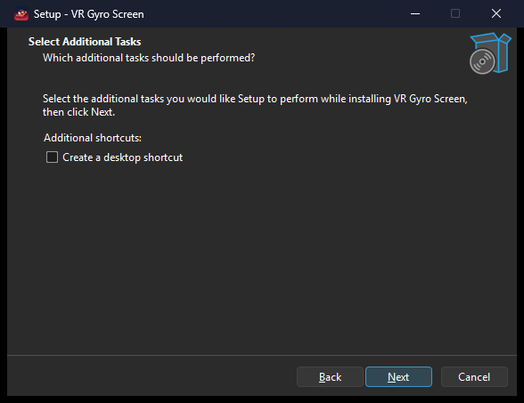
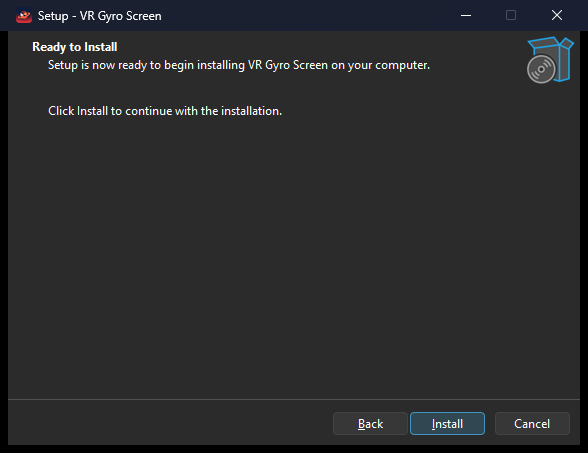
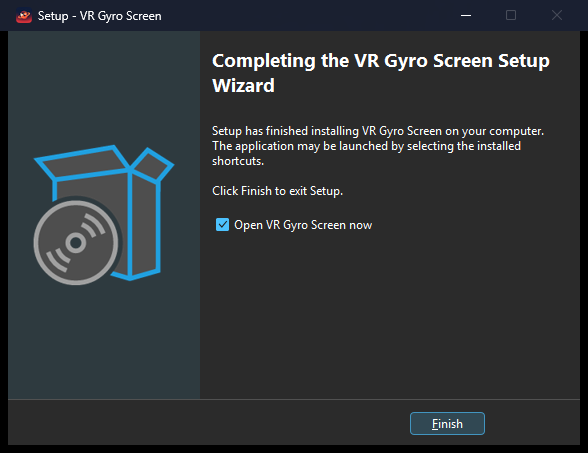
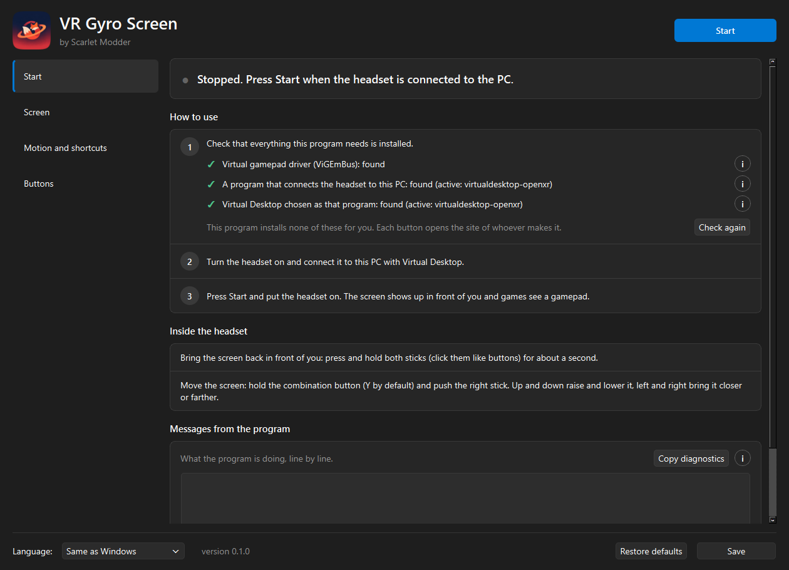
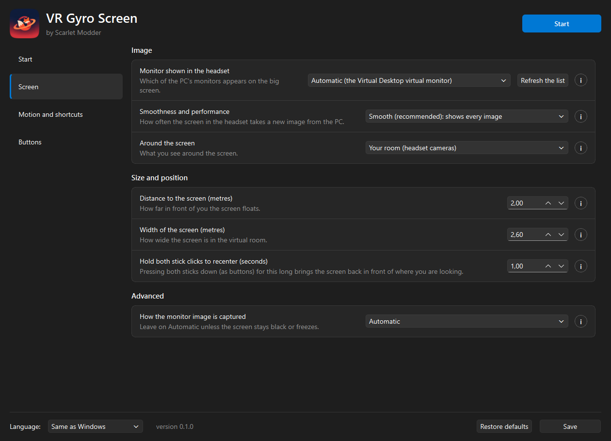
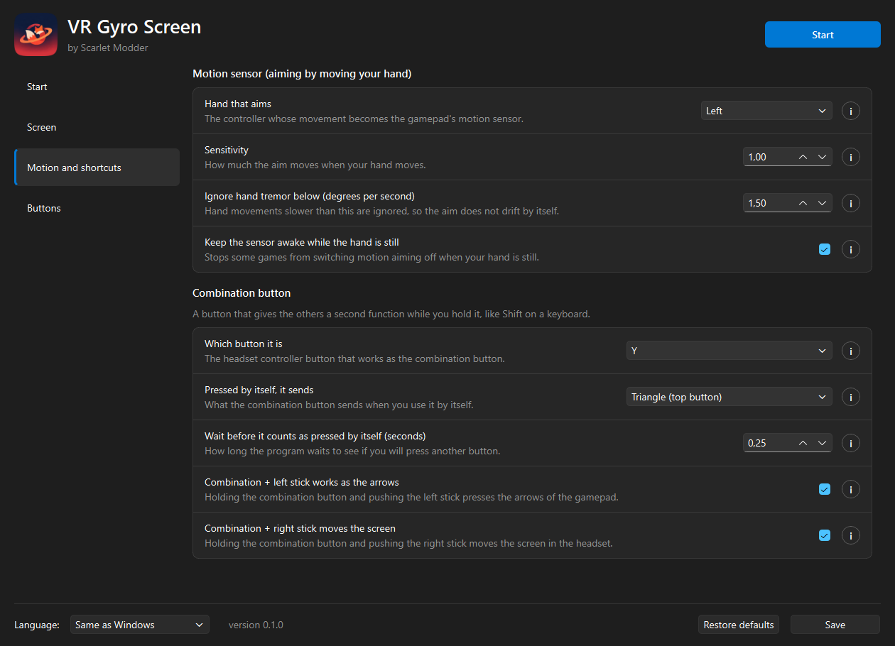
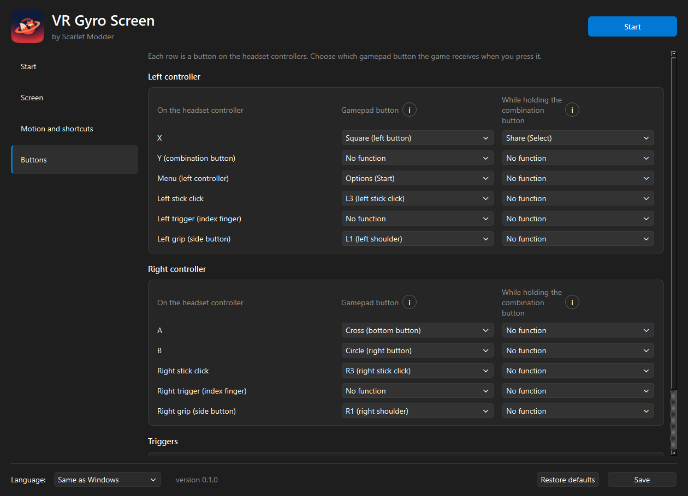
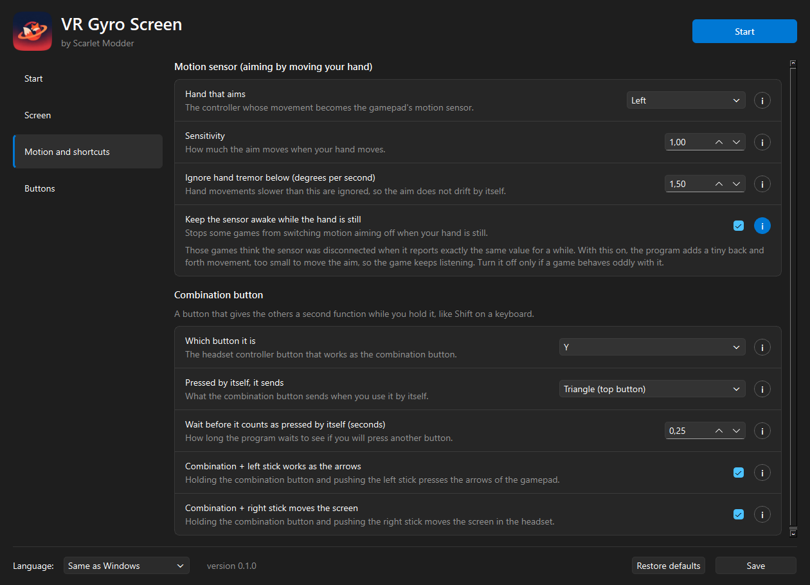

**English** | [Português](usage.pt-BR.md)

# 🧭 Usage

This page takes you from installing the program to playing: what to install first, how the settings window works, what to check in Virtual Desktop and in the headset, why the game runs on a second (virtual) monitor, how to recenter the screen, and what each controller button does. The command line is at the end. Back to the [README](../README.md).

## 🚀 Install and run

What you need:

| Requirement | Why |
|---|---|
| Windows 11 | The app uses Windows display capture and only runs on Windows |
| A headset connected through Virtual Desktop (Streamer on the PC, app in the headset) | The image and the controllers travel through it |
| The Virtual Desktop OpenXR runtime (VDXR) active | OpenXR is the standard that lets programs talk to a VR headset. The runtime is the program on the PC that does that work. The app uses it to draw the screen and read the controllers |
| ViGEmBus driver | A free driver that lets programs create a virtual gamepad. The app uses it to create the virtual DualShock 4 that games see |

> [!NOTE]
> Only the Meta Quest with Virtual Desktop and its OpenXR runtime was tested. Other OpenXR runtimes and other headsets were not tested.

### Install

1. Get the installer, `VRGyroScreen-Setup-vX.Y.Z.exe`. It is built with `scripts\build.ps1`. Published versions go to the Releases page of the repository.
2. Run it. It installs for your Windows user only, so it does not ask for administrator rights. It can speak English or Brazilian Portuguese.

   
3. The page **What this program needs** lists ViGEmBus and Virtual Desktop. For each one it says **found** or **not found**, and a button opens the official site. **Check again** reads the situation again after you install something. The installer does not install either of them: you download and install them yourself, now or later.

   
4. It creates a shortcut in the Start menu. A desktop shortcut is optional, off unless you tick it.

   
5. The next page confirms that everything is ready. Press **Install**.

   
6. On the last page, leave **Open VR Gyro Screen now** ticked to open the program right away, and press **Finish**.

   

If the settings window is open while you install a new version, the installer asks you to close it first.

To uninstall, use the Windows list of installed apps. The uninstaller removes the program and then asks whether to remove your settings too (screen, motion and buttons). The answer that is already selected is **No**, which keeps them for a future installation.

### Play

1. Open **VR Gyro Screen** from the Start menu. The settings window opens on the **Start** page.
2. Step 1 of that page checks what the program needs, like the installer page: a green mark when an item was found, an orange one with a link to the official site when it was not.
3. Turn the headset on and connect it to the PC with Virtual Desktop.
4. Press the **Start** button at the top of the window, then put the headset on. The screen shows up in front of you and games see a gamepad.
5. When you are done, press **Stop**. Closing the window also stops the app.



Pressing **Start** saves the settings first. If an item is still missing, the window says which one and asks whether to start anyway.

### The settings window

The menu on the left has four pages:

| Page | What it has |
|---|---|
| **Start** | The status (Stopped, Running, Closing, or Closed with a problem), the checklist, a reminder of what to do inside the headset, and the messages from the program |
| **Screen** | Which monitor appears in the headset, smoothness and performance, what you see around the screen, distance, width, how long to hold both sticks to recenter, and, under **Advanced**, how the monitor image is captured |
| **Motion and shortcuts** | The hand that aims, sensitivity, how much hand tremor to ignore, keeping the sensor awake, and the combination button |
| **Buttons** | One card per controller. For each button: the gamepad button it sends alone, and the one it sends while you hold the combination button. Then which input works as each trigger |

The **Screen** page:



The **Motion and shortcuts** page:



The **Buttons** page:



Under the name of each option, one sentence says what it is for. The **i** button next to it opens the full explanation (it also shows when the mouse rests on the button).



At the bottom of the window:

- **Language**: Same as Windows, Português (Brasil) or English. The window reopens in the new language and keeps what you typed. It cannot change while the app is running.
- **Restore defaults** fills every field with the built-in values. Nothing changes until you press **Save**.
- **Save** writes the settings. They take effect the next time you press **Start**. If the app is running, an **Apply now** button appears next to it: it closes and starts the app again with the new settings (the screen disappears for a moment).

The messages area on the **Start** page shows what the program is doing, line by line. If something goes wrong, the reason shows up there. **Copy diagnostics** puts those messages on the clipboard, with a summary of your setup (version, Windows, what was found, the monitors), ready to paste when you ask for help.

Only one settings window opens at a time. Opening the program again brings the open window to the front.

## ✅ What to check before you play

Open the Virtual Desktop menu inside the headset and check these items.

| Where | Setting | Why |
|---|---|---|
| Virtual Desktop, **INPUT** tab | **Use controllers as gamepad**: off | When it is on, Virtual Desktop takes the controllers for itself. The app receives no input, and the game would see two controllers |
| Headset settings | Hand tracking: off | With it on, when you put the controllers down the headset switches to your hands, the pose jumps and a pinch becomes a trigger press. The game "plays by itself" |
| Virtual Desktop, **STREAMING** tab | Frame rate | The rate you pick here is the rate of the virtual monitor. Use the same rate in the game. Validated at 90 and at 120 |
| Windows | Virtual Desktop OpenXR runtime (VDXR) active | The app talks to the headset through OpenXR. In Virtual Desktop Streamer, on the PC, open Options and choose VDXR as the OpenXR runtime |

> [!WARNING]
> Changing the frame rate, or reconnecting the headset, makes Virtual Desktop remove its virtual monitor and create another one with a different name in Windows. The app notices, waits for the new monitor and reopens the capture by itself. Your game may need a moment on the new monitor.

## 🖥️ Why a second monitor

The app shows **one Windows monitor** in the headset. By default it picks the virtual monitor that Virtual Desktop creates. Running the game on that monitor, in full screen, has three effects:

- **Frame rate.** The virtual monitor is not tied to the 60 Hz of common physical monitors. On the validation machine, Windows listed 60, 72, 80, 90, 96, 100, 120 and 144 Hz for it. The game renders at the headset rate, so the image reaches the headset without the uneven cadence of 60 frames shown at 90.
- **Your physical monitor is free.** You can use it for something else, or leave it off.
- **Resolution.** The virtual monitor was 2560x1440 in the validation.

How to create the virtual monitor in Virtual Desktop: I could not confirm the steps from the official pages, so this project does not describe them. See the Virtual Desktop documentation at [vrdesktop.net](https://www.vrdesktop.net) and its release notes. The app only needs the virtual monitor to show up in Windows.

If there is no virtual monitor, the app picks a monitor that is not the primary one, and as a last resort the primary one. To pick another one, use **Monitor shown in the headset** on the **Screen** page (**Refresh the list** reads the monitors again), or run `vr-gyro-screen monitors` to see the choice.

### Send the game to that monitor

Most games go full screen on the monitor their window is on. This command moves a window to the headset monitor and presses the game's full screen key until the window covers the monitor. It exists only on the command line (see [From the command line](#%EF%B8%8F-from-the-command-line)):

```bash
vr-gyro-screen window "part of the window title"
```

| Option | Default | What it does |
|---|---|---|
| `--monitor` | `auto` | Which monitor to use, same values as in the configuration |
| `--fullscreen-key` | `f11` | `f11`, `alt+enter` or `none`. With `none` the window is only moved and maximized |
| `--wait` | `60` | Seconds to wait for the window to appear |

The command exits with 0 when the window ends up covering the monitor, and with 1 otherwise.

## 🎯 Recenter the screen

The screen floats in an arc in front of where you were facing at the last recenter. There are three ways to bring it back.

| Way | How | What it does |
|---|---|---|
| 1. Both stick clicks | Hold the left and right stick clicks for 1 second | The screen comes to where your head is looking, in direction and height |
| 2. Headset recenter | Hold the Meta button, as you always do | The app notices and puts the screen in front of you, keeping the height you had set |
| 3. Fine adjustment | Hold **Y** and move the right stick | Up and down move the screen along an arc. Right brings it nearer, left takes it farther |

- The hold time of way 1 is on the **Screen** page, or `recenter.hold_s` in the [configuration](configuration.md).
- The distance is kept between 0.8 m and 6 m.
- The position is saved between sessions, in `screen.json` in the app folder (`%APPDATA%\vr-gyro-screen`).
- The **Screen** page of the window shows the distance you last adjusted inside the headset, and the value you leave in that field is the one used when you press **Start**.
- From the command line, the saved distance wins over `screen.distance_m` in the file, because it holds what you last adjusted by hand. `--distance` replaces it, becomes the new saved distance, and keeps the saved height. Delete `screen.json` to go back to the configured value.
- Y plus the right stick never reaches the game.

## 🎮 Controls

Each controller button becomes the button at the same position on a standard gamepad layout.

| Controller | Gamepad button |
|---|---|
| A (bottom) | CROSS |
| B (right) | CIRCLE |
| X (left) | SQUARE |
| Y (top) | TRIANGLE, see the combination key below |
| Grips | SHOULDER_LEFT, SHOULDER_RIGHT |
| Triggers | Left and right triggers |
| Stick clicks | THUMB_LEFT, THUMB_RIGHT |
| Menu button | OPTIONS |
| Sticks | Left and right sticks |

The controllers have fewer buttons than a gamepad, so **Y** is a combination key:

| You do | Result |
|---|---|
| Y + left stick | Directional pad |
| Y + X | SHARE |
| Y + right stick | Moves the screen, see above |
| Y alone | TRIANGLE: a short tap, or held after 0.25 s |

You can change all of this on the **Buttons** and **Motion and shortcuts** pages of the window, or in the [configuration](configuration.md) file.

### Motion aiming

- The **right hand** aims by default. Point the controller at the screen. Use **Hand that aims** (`gyro.hand`) to switch.
- The game must support gyro aiming and recognize a DualShock 4.
- Tune the sensitivity **in the game first**. Then **Sensitivity** (`gyro.scale`) multiplies the movement of your hand before it reaches the game: 2 doubles it, 0.5 halves it, 0 turns motion aiming off.
- When the headset menu is open, the app sends a neutral report, so no button stays pressed.

## ⌨️ From the command line

The settings window covers everyday use. The command line is useful for developers, for the `monitors`, `window` and `bench` helpers, and to check a setup.

- **Installed copy.** The installation folder has `vr-gyro-screen-cli.exe`. It takes the same commands as `vr-gyro-screen` below.
- **From the source code.** You need Python 3.11 or newer (validated with 3.13). In a clone of the repository, run `pip install .`. It also installs the ViGEmBus driver, through the `vgamepad` package. For the optional `dxcam` capture backend, use `pip install ".[dxcam]"`.

| Command | What it does |
|---|---|
| `vr-gyro-screen` or `vr-gyro-screen run` | Shows the monitor in the headset and creates the gamepad |
| `vr-gyro-screen settings` | Opens the settings window |
| `vr-gyro-screen check` | Says whether ViGEmBus and the OpenXR runtime were found (with the site to get each missing one), then whether each library the app uses loads. Exits with 1 only when a library fails |
| `vr-gyro-screen monitors` | Lists the monitors, marks the primary one and the one your configuration selects. `--monitor` tries another selector, `--config` reads another file |
| `vr-gyro-screen window "title"` | Sends a window to the headset monitor and makes it full screen |
| `vr-gyro-screen bench` | Measures the processor cost of each capture backend, without a headset |

Options of `run`:

| Option | What it does |
|---|---|
| `--config FILE` | Configuration file (default: `%APPDATA%\vr-gyro-screen\config.toml`) |
| `--profile` | `performance` or `smooth` |
| `--monitor` | `auto`, a position from `monitors`, or part of a monitor name |
| `--backend` | `auto`, `gpu`, `direct` or `dxcam` |
| `--background` | `auto`, `passthrough` or `black` |
| `--distance M` | Distance to the screen, in metres, from 0.8 to 6. Replaces the saved distance |
| `--width M` | Width of the screen, in metres |
| `--quiet` | Does not print the timing line every 10 seconds |
| `--stop-file FILE` | Closes cleanly as soon as this file exists. The settings window uses it to stop the app |

<details>
<summary>Options of <code>bench</code></summary>

| Option | Default | What it does |
|---|---|---|
| `--monitor` | `auto` | Monitor to capture |
| `--backend` | all three | `gpu`, `direct` or `dxcam`. Repeat the option to compare several |
| `--seconds` | `8` | Duration of each test |
| `--rate` | `90` | Cycles per second, like the headset |
| `--no-mipmaps` | off | Skips the mipmap step |

</details>

Press Ctrl+C in the command line to stop the app.

## 🔒 What stays on your machine

The app reads one monitor and the controller state. It writes only in `%APPDATA%\vr-gyro-screen`:

- `config.toml`, the settings, written when you press **Save** or **Start** in the window (or created by you), and `config.toml.bak`, a copy of the file you wrote by hand, kept the first time the window replaces it;
- `screen.json`, the saved screen position;
- `last-run.log`, what the program said the last time it ran (the same lines as **Messages from the program**);
- `window.json`, the language chosen in the window;
- `stop-request`, a short-lived file the window creates to ask the app to stop.

The program itself stays in its installation folder.
