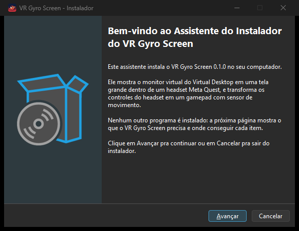
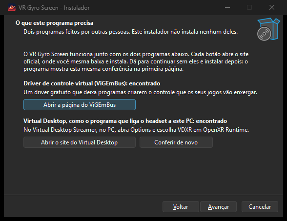
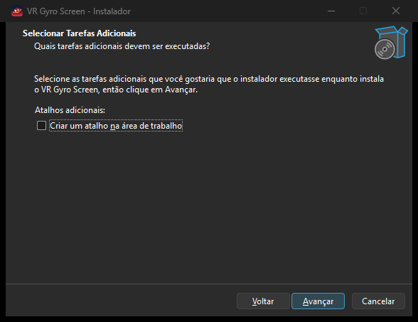
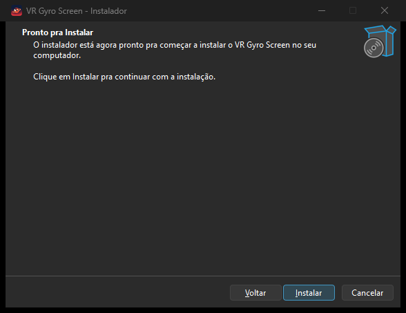
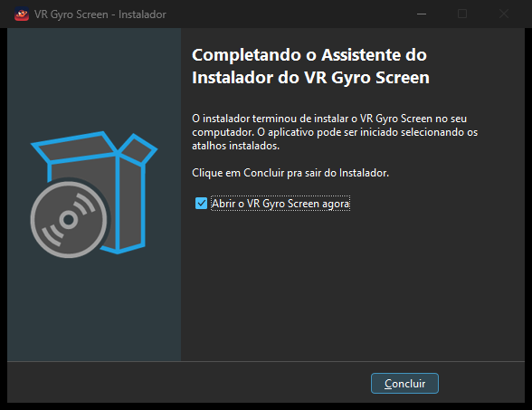
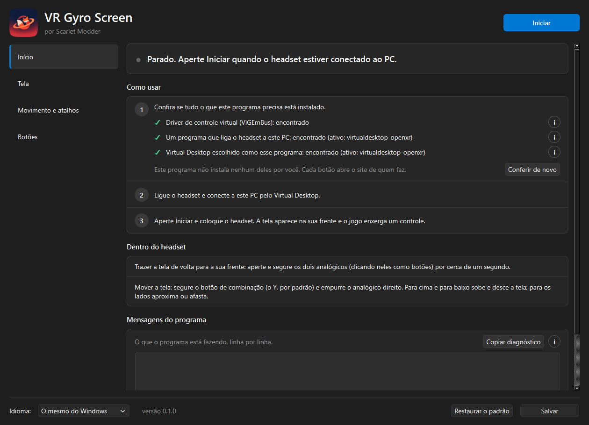
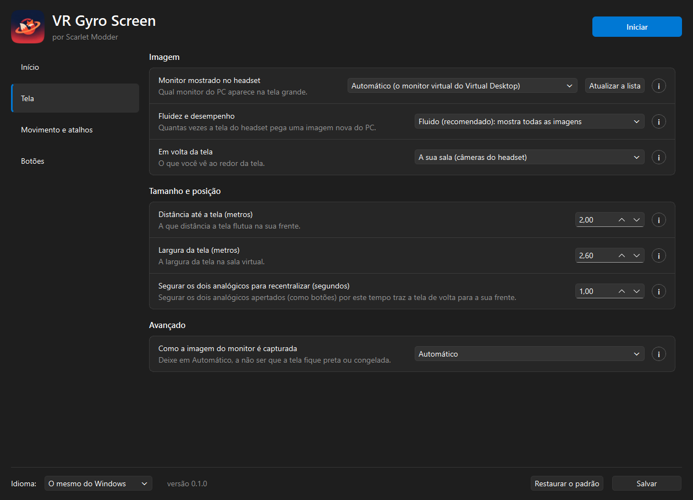
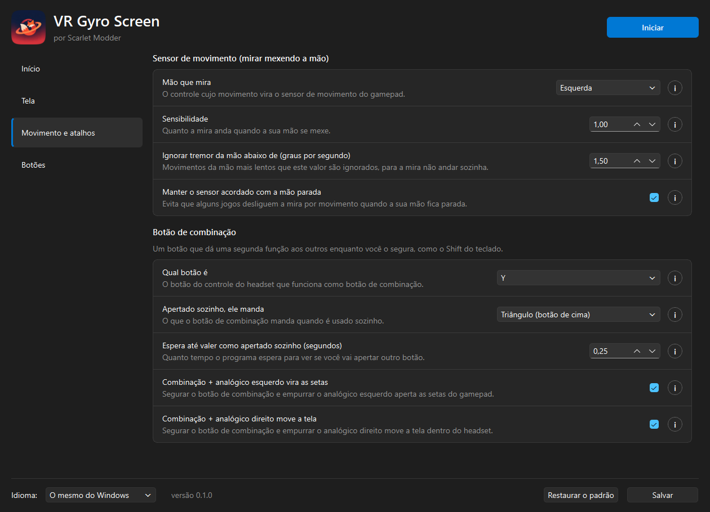
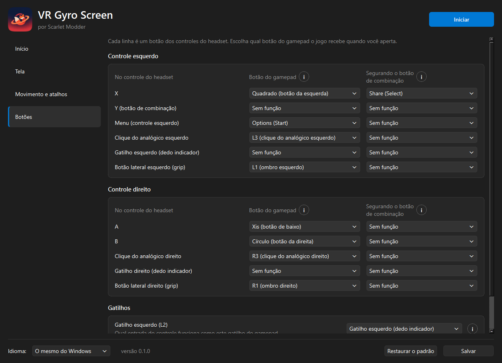
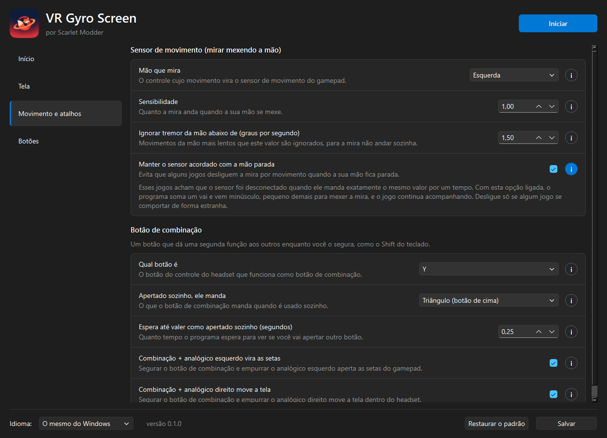

[English](usage.md) | **Português**

# 🧭 Uso

Esta página leva você da instalação até o jogo: o que instalar antes, como funciona a janela de configuração, o que conferir no Virtual Desktop e no headset, por que o jogo roda num segundo monitor (o virtual), como recentralizar a tela e o que cada botão do controle faz. A linha de comando fica no fim. Voltar ao [README](../README.pt-BR.md).

## 🚀 Instalar e rodar

O que você precisa:

| Requisito | Por quê |
|---|---|
| Windows 11 | O app usa a captura de tela do Windows e só roda no Windows |
| Um headset conectado pelo Virtual Desktop (Streamer no PC, app no headset) | A imagem e os controles passam por ele |
| O runtime OpenXR do Virtual Desktop (VDXR) ativo | OpenXR é o padrão que deixa programas conversarem com um headset de VR. O runtime é o programa no PC que faz esse trabalho. O app usa esse runtime para desenhar a tela e ler os controles |
| Driver ViGEmBus | Um driver gratuito que deixa programas criarem um controle virtual. O app usa esse driver para criar o DualShock 4 virtual que o jogo enxerga |

> [!NOTE]
> Só o Meta Quest com Virtual Desktop e o runtime OpenXR dele foi testado. Outros runtimes OpenXR e outros headsets não foram testados.

### Instalar

1. Pegue o instalador, `VRGyroScreen-Setup-vX.Y.Z.exe`. Ele é gerado com `scripts\build.ps1`. As versões publicadas vão para a página de Releases do repositório.
2. Rode o instalador. Ele instala só para o seu usuário do Windows, por isso não pede administrador. Ele fala português do Brasil ou inglês.

   
3. A página **O que este programa precisa** mostra o ViGEmBus e o Virtual Desktop. Para cada um ela diz **encontrado** ou **não encontrado**, e um botão abre o site oficial. **Conferir de novo** olha outra vez depois que você instala alguma coisa. O instalador não instala nenhum dos dois: você baixa e instala cada um por conta própria, agora ou depois.

   
4. Ele cria um atalho no menu Iniciar. O atalho na área de trabalho é opcional e só aparece se você marcar.

   
5. A página seguinte confirma que está tudo pronto. Aperte **Instalar**.

   
6. Na última página, deixe **Abrir o VR Gyro Screen agora** marcado para abrir o programa na hora, e aperte **Concluir**.

   

Se a janela de configuração estiver aberta quando você instalar uma versão nova, o instalador pede para fechá-la antes.

Para desinstalar, use a lista de aplicativos instalados do Windows. O desinstalador remove o programa e depois pergunta se você quer remover também as suas configurações (tela, movimento e botões). A resposta que já vem marcada é **Não**, que guarda as configurações para uma instalação futura.

### Jogar

1. Abra o **VR Gyro Screen** pelo menu Iniciar. A janela de configuração abre na página **Início**.
2. O passo 1 dessa página confere o que o programa precisa, como a página do instalador: uma marca verde quando o item foi encontrado, uma laranja com um botão para o site oficial quando não foi.
3. Ligue o headset e conecte ao PC pelo Virtual Desktop.
4. Aperte o botão **Iniciar**, no alto da janela, e coloque o headset. A tela aparece na sua frente e o jogo enxerga um controle.
5. Quando terminar, aperte **Parar**. Fechar a janela também para o app.



Apertar **Iniciar** salva as configurações antes. Se ainda faltar algum item, a janela diz qual é e pergunta se você quer iniciar mesmo assim.

### A janela de configuração

O menu da esquerda tem quatro páginas:

| Página | O que tem |
|---|---|
| **Início** | A situação (Parado, Rodando, Fechando, ou Fechou com um problema), a conferência do que o programa precisa, um lembrete do que fazer dentro do headset e as mensagens do programa |
| **Tela** | Qual monitor aparece no headset, fluidez e desempenho, o que você vê em volta da tela, distância, largura, quanto tempo segurar os dois analógicos para recentralizar e, em **Avançado**, como a imagem do monitor é capturada |
| **Movimento e atalhos** | A mão que mira, a sensibilidade, quanto do tremor da mão ignorar, manter o sensor acordado e o botão de combinação |
| **Botões** | Um cartão para cada controle. Para cada botão: o botão do gamepad que ele manda sozinho e o que ele manda enquanto você segura o botão de combinação. Depois, qual entrada funciona como cada gatilho |

A página **Tela**:



A página **Movimento e atalhos**:



A página **Botões**:



Embaixo do nome de cada opção, uma frase diz para que ela serve. O botão **i** ao lado abre a explicação completa (ela também aparece quando o mouse para em cima do botão).



Na parte de baixo da janela:

- **Idioma**: O mesmo do Windows, Português (Brasil) ou English. A janela reabre no idioma novo e mantém o que você já tinha preenchido. Não dá para trocar com o app rodando.
- **Restaurar o padrão** preenche todos os campos com os valores do programa. Nada muda até você apertar **Salvar**.
- **Salvar** grava as configurações. Elas passam a valer na próxima vez que você apertar **Iniciar**. Se o app estiver rodando, aparece ao lado o botão **Aplicar agora**: ele fecha e inicia o app de novo com as novas configurações (a tela some por um instante).

A área de mensagens da página **Início** mostra o que o programa está fazendo, linha por linha. Se algo der errado, o motivo aparece ali. **Copiar diagnóstico** copia essas mensagens com um resumo da sua instalação (versão, Windows, o que foi encontrado, os monitores), prontos para colar quando você pedir ajuda.

Só abre uma janela de configuração por vez. Abrir o programa de novo traz para a frente a janela que já está aberta.

## ✅ O que conferir antes de jogar

Abra o menu do Virtual Desktop dentro do headset e confira estes itens.

| Onde | Ajuste | Por quê |
|---|---|---|
| Virtual Desktop, aba **INPUT** | **Use controllers as gamepad**: desligado | Ligado, o Virtual Desktop toma os controles para si. O app não recebe entrada e o jogo veria dois controles |
| Configurações do headset | Rastreamento de mãos: desligado | Ligado, ao soltar os controles o headset troca para as mãos, a pose pula e o gesto de pinça vira gatilho. O jogo "joga sozinho" |
| Virtual Desktop, aba **STREAMING** | Taxa de quadros | A taxa escolhida ali é a taxa do monitor virtual. Use a mesma taxa no jogo. Validado a 90 e a 120 |
| Windows | Runtime OpenXR do Virtual Desktop (VDXR) ativo | O app conversa com o headset por OpenXR. No Virtual Desktop Streamer, no PC, abra Options e escolha VDXR em OpenXR Runtime |

> [!WARNING]
> Mudar a taxa de quadros, ou reconectar o headset, faz o Virtual Desktop remover o monitor virtual e criar outro com nome diferente no Windows. O app percebe, espera o novo monitor e reabre a captura sozinho. Seu jogo pode precisar de um instante no monitor novo.

## 🖥️ Por que um segundo monitor

O app mostra **um monitor do Windows** no headset. Por padrão ele escolhe o monitor virtual que o Virtual Desktop cria. Rodar o jogo nesse monitor, em tela cheia, tem três efeitos:

- **Taxa de quadros.** O monitor virtual não está preso aos 60 Hz dos monitores físicos comuns. Na máquina de validação, o Windows listou 60, 72, 80, 90, 96, 100, 120 e 144 Hz para ele. O jogo renderiza na taxa do headset, e a imagem chega ao headset sem a cadência irregular de 60 quadros mostrados a 90.
- **Seu monitor físico fica livre.** Você pode usá-lo para outra coisa, ou deixá-lo desligado.
- **Resolução.** O monitor virtual tinha 2560x1440 na validação.

Como criar o monitor virtual no Virtual Desktop: não consegui confirmar os passos nas páginas oficiais, então este projeto não os descreve. Veja a documentação do Virtual Desktop em [vrdesktop.net](https://www.vrdesktop.net) e as notas de versão dele. O app só precisa que o monitor virtual apareça no Windows.

Sem monitor virtual, o app escolhe um monitor que não seja o principal e, em último caso, o principal. Para escolher outro, use **Monitor mostrado no headset** na página **Tela** (**Atualizar a lista** lê os monitores de novo), ou rode `vr-gyro-screen monitors` para ver a escolha.

### Mandar o jogo para esse monitor

A maioria dos jogos entra em tela cheia no monitor em que a janela está. Este comando move uma janela para o monitor do headset e aperta a tecla de tela cheia do jogo até a janela cobrir o monitor. Ele só existe na linha de comando (veja [Pela linha de comando](#%EF%B8%8F-pela-linha-de-comando)):

```bash
vr-gyro-screen window "parte do título da janela"
```

| Opção | Padrão | O que faz |
|---|---|---|
| `--monitor` | `auto` | Qual monitor usar, mesmos valores da configuração |
| `--fullscreen-key` | `f11` | `f11`, `alt+enter` ou `none`. Com `none` a janela só é movida e maximizada |
| `--wait` | `60` | Segundos de espera até a janela aparecer |

O comando termina com 0 quando a janela cobre o monitor, e com 1 caso contrário.

## 🎯 Recentralizar a tela

A tela flutua num arco à frente de onde você olhava no último recentralizar. Há três jeitos de trazê-la de volta.

| Jeito | Como | O que faz |
|---|---|---|
| 1. Dois cliques dos analógicos | Segure o clique do analógico esquerdo e o do direito por 1 segundo | A tela vem para onde a cabeça está olhando, em direção e altura |
| 2. Recentralizar do headset | Segure o botão Meta, como sempre | O app percebe e põe a tela à sua frente, mantendo a altura que você tinha ajustado |
| 3. Ajuste fino | Segure **Y** e mexa o analógico direito | Para cima e para baixo move a tela num arco. Para a direita aproxima, para a esquerda afasta |

- O tempo de segurar do jeito 1 fica na página **Tela**, ou em `recenter.hold_s` na [configuração](configuration.pt-BR.md).
- A distância fica entre 0,8 m e 6 m.
- A posição é salva entre as sessões, em `screen.json` na pasta do app (`%APPDATA%\vr-gyro-screen`).
- A página **Tela** da janela mostra a distância que você ajustou por último dentro do headset, e o valor que ficar nesse campo é o usado quando você aperta **Iniciar**.
- Pela linha de comando, a distância salva vale mais que o `screen.distance_m` do arquivo, porque guarda o que você ajustou à mão por último. `--distance` a substitui, passa a ser a nova distância salva e mantém a altura salva. Apague `screen.json` para voltar ao valor configurado.
- Y mais o analógico direito nunca chega ao jogo.

## 🎮 Controles

Cada botão do controle vira o botão na mesma posição de um layout padrão de gamepad.

| Controle | Botão do gamepad |
|---|---|
| A (embaixo) | CROSS |
| B (direita) | CIRCLE |
| X (esquerda) | SQUARE |
| Y (em cima) | TRIANGLE, veja a tecla de combinação abaixo |
| Grips | SHOULDER_LEFT, SHOULDER_RIGHT |
| Gatilhos | Gatilhos esquerdo e direito |
| Cliques dos analógicos | THUMB_LEFT, THUMB_RIGHT |
| Botão de menu | OPTIONS |
| Analógicos | Analógicos esquerdo e direito |

Os controles têm menos botões que um gamepad, então **Y** é uma tecla de combinação:

| Você faz | Resultado |
|---|---|
| Y + analógico esquerdo | Direcional |
| Y + X | SHARE |
| Y + analógico direito | Move a tela, veja acima |
| Y sozinho | TRIANGLE: um toque curto, ou segurado depois de 0,25 s |

Dá para mudar tudo isso nas páginas **Botões** e **Movimento e atalhos** da janela, ou no arquivo de [configuração](configuration.pt-BR.md).

### Mira por movimento

- A **mão direita** mira por padrão. Aponte o controle para a tela. Use **Mão que mira** (`gyro.hand`) para trocar.
- O jogo precisa ter mira por giroscópio e reconhecer um DualShock 4.
- Ajuste a sensibilidade **primeiro no jogo**. Depois, **Sensibilidade** (`gyro.scale`) multiplica o movimento da sua mão antes de ele chegar ao jogo: 2 dobra, 0,5 reduz pela metade, 0 desliga a mira por movimento.
- Com o menu do headset aberto, o app manda um relatório neutro, para nenhum botão ficar preso.

## ⌨️ Pela linha de comando

A janela de configuração cobre o uso do dia a dia. A linha de comando serve para quem desenvolve, para os auxiliares `monitors`, `window` e `bench`, e para conferir uma instalação.

- **Cópia instalada.** A pasta de instalação tem o `vr-gyro-screen-cli.exe`. Ele aceita os mesmos comandos do `vr-gyro-screen` abaixo.
- **A partir do código-fonte.** Você precisa de Python 3.11 ou mais novo (validado com 3.13). Num clone do repositório, rode `pip install .`. Ele também instala o driver ViGEmBus, pelo pacote `vgamepad`. Para o backend de captura opcional `dxcam`, use `pip install ".[dxcam]"`.

| Comando | O que faz |
|---|---|
| `vr-gyro-screen` ou `vr-gyro-screen run` | Mostra o monitor no headset e cria o controle |
| `vr-gyro-screen settings` | Abre a janela de configuração |
| `vr-gyro-screen check` | Diz se o ViGEmBus e o runtime OpenXR foram encontrados (com o site de cada um que faltar) e depois se cada biblioteca que o app usa carrega. Termina com 1 só quando uma biblioteca falha |
| `vr-gyro-screen monitors` | Lista os monitores, marca o principal e o que a sua configuração seleciona. `--monitor` experimenta outro seletor, `--config` lê outro arquivo |
| `vr-gyro-screen window "título"` | Manda uma janela para o monitor do headset e põe em tela cheia |
| `vr-gyro-screen bench` | Mede o custo de processador de cada backend de captura, sem headset |

Opções de `run`:

| Opção | O que faz |
|---|---|
| `--config ARQUIVO` | Arquivo de configuração (padrão: `%APPDATA%\vr-gyro-screen\config.toml`) |
| `--profile` | `performance` ou `smooth` |
| `--monitor` | `auto`, uma posição de `monitors`, ou parte do nome de um monitor |
| `--backend` | `auto`, `gpu`, `direct` ou `dxcam` |
| `--background` | `auto`, `passthrough` ou `black` |
| `--distance M` | Distância até a tela, em metros, de 0,8 a 6. Substitui a distância salva |
| `--width M` | Largura da tela, em metros |
| `--quiet` | Não imprime a linha de tempos a cada 10 segundos |
| `--stop-file ARQUIVO` | Fecha de forma limpa assim que esse arquivo existir. É assim que a janela de configuração para o app |

<details>
<summary>Opções de <code>bench</code></summary>

| Opção | Padrão | O que faz |
|---|---|---|
| `--monitor` | `auto` | Monitor a capturar |
| `--backend` | os três | `gpu`, `direct` ou `dxcam`. Repita a opção para comparar vários |
| `--seconds` | `8` | Duração de cada teste |
| `--rate` | `90` | Ciclos por segundo, como o headset |
| `--no-mipmaps` | desligado | Pula a etapa de mipmaps |

</details>

Aperte Ctrl+C na linha de comando para parar o app.

## 🔒 O que fica na sua máquina

O app lê um monitor e o estado dos controles. Ele só grava em `%APPDATA%\vr-gyro-screen`:

- `config.toml`, as configurações, gravado quando você aperta **Salvar** ou **Iniciar** na janela (ou criado por você), e `config.toml.bak`, uma cópia do arquivo que você escreveu à mão, guardada na primeira vez que a janela o substitui;
- `screen.json`, a posição salva da tela;
- `last-run.log`, o que o programa disse na última vez que rodou (as mesmas linhas de **Mensagens do programa**);
- `window.json`, o idioma escolhido na janela;
- `stop-request`, um arquivo de vida curta que a janela cria para pedir ao app que pare.

O programa em si fica na pasta de instalação.
